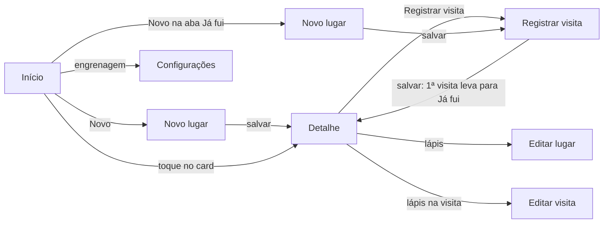

# Diário de Rolê

PWA pessoal para guardar os bares e restaurantes que você quer conhecer e o histórico de cada visita. Funciona 100% offline e pode ser instalado na tela inicial do celular. Os dados ficam só no aparelho: não há servidor, login nem analytics.

O app responde rápido à pergunta "onde a gente vai hoje?". Ele tem uma lista **Quero ir**, que vira **Já fui** quando a primeira visita é registrada. Cada visita guarda a data, a nota, se você voltaria e um comentário.

**Status:** versão **1.2.0** publicada (o histórico está no [CHANGELOG](CHANGELOG.md)). O MVP (1.0) foi completado com Configurações e tema escuro (1.1) e com atalhos para sair de casa (1.2). Registros mais ricos (1.3) e estatísticas (1.4) estão planejados. Fotos, mapa, login e migração para React foram descartados: o app continua 100% local. Veja o [Roadmap](#roadmap).

---

## Sumário

- [Funcionalidades](#funcionalidades)
- [Telas e navegação](#telas-e-navegação)
- [Regras de negócio](#regras-de-negócio)
- [Arquitetura](#arquitetura)
- [Tecnologias](#tecnologias)
- [Rodar localmente](#rodar-localmente)
- [Publicar e atualizar](#publicar-e-atualizar)
- [Privacidade e segurança dos dados](#privacidade-e-segurança-dos-dados)
- [Limitações conhecidas](#limitações-conhecidas)
- [Roadmap](#roadmap)
- [Documentação do projeto](#documentação-do-projeto)

---

## Funcionalidades

**Lugares**
- Cadastro com nome, tipo, tags e endereço. O tipo vem de uma lista fixa: Bar, Restaurante, Pizzaria, Hamburgueria, Café, Lanchonete, Balada e Outro. O endereço tem campos separados: logradouro, número, complemento, bairro, cidade e UF.
- Tags livres em chips. Enquanto você digita, o app sugere as tags que já existem e reaproveita a grafia delas: com "BH" cadastrada, digitar "bh" usa "BH".
- Edição e exclusão. Excluir um lugar apaga também as visitas dele, depois de uma confirmação que diz quantas visitas vão junto.
- Favoritos: um coração no card e no detalhe.
- **Abrir no Maps:** no detalhe de um lugar com endereço, abre a busca do lugar no Google Maps (o app do Maps, se estiver instalado).
- **Compartilhar lugar:** manda para outro app (WhatsApp, por exemplo) um texto com nome, tipo, nota, endereço e link do Maps. No computador, o texto é copiado.

**Visitas**
- Registro com data, nota de 1 a 5 estrelas, "voltaria?" (sim ou não) e comentário opcional.
- A primeira visita leva o lugar de "Quero ir" para "Já fui", sozinha.
- Edição e exclusão de visitas. O lugar continua em "Já fui" mesmo sem visitas.
- No detalhe do lugar: média das notas, número de visitas, "voltaria" da última visita e histórico, da mais recente para a mais antiga.

**Encontrar lugares**
- Abas **Quero ir** e **Já fui**, com contador.
- Busca por nome enquanto você digita, sem diferenciar maiúsculas nem acentos ("ze" encontra "Bar do Zé").
- Filtros por tipo, tags e "só favoritos". Na aba "Já fui" há também "voltaria = sim" e nota mínima.
- Ordenação por aba, na linha "Ordenar: … ▾" acima da lista. Em "Quero ir": adicionados mais recentes, adicionados mais antigos e A–Z. Em "Já fui": última visita mais recente, última visita mais antiga, A–Z, maior nota e mais visitados.
- A aba, a busca e os filtros ficam no endereço da página, então continuam aplicados quando você abre um lugar e volta. A ordem de cada aba fica salva no aparelho e continua valendo quando o app é reaberto.
- **Sortear:** o botão "Sortear", ao lado da ordenação, escolhe um lugar ao acaso entre os que estão na lista (com busca e filtros). O painel "Sorteado!" tem "Sortear de novo" e "Ver lugar".

**Backup** (em Configurações)
- **Baixar arquivo** salva um `.json` com todos os lugares e visitas.
- **Compartilhar** abre o menu do Android para mandar o backup direto ao Drive, WhatsApp ou e-mail, como `.json.txt` (o Chrome do Android não compartilha `.json`). O botão só aparece onde o navegador consegue compartilhar arquivos.
- **Importar** um backup (`.json` ou `.json.txt`), escolhendo entre **mesclar** com os dados atuais ou **substituir tudo**. O arquivo é validado inteiro antes de gravar, e qualquer erro deixa os dados como estavam.
- **Lembrete** na tela inicial quando o último backup tem mais de 30 dias.
- **Apagar todos os dados**, com confirmação em dois passos.

**App**
- **Configurações**, pela engrenagem da tela inicial: Aparência, Backup, Dados e Sobre (versão do app).
- **Tema** Automático (segue o celular), Claro ou Escuro, aplicado desde a abertura, sem piscar.
- Instalável na tela inicial do Android, abrindo em tela cheia, sem a barra do navegador.
- **Atalhos do ícone:** segurando o ícone do app aparecem "Novo" (cadastrar lugar) e "Sortear" (sorteia entre todos os lugares de "Quero ir").
- Funciona offline depois da primeira vez que é aberto.
- Avisa quando há uma versão nova ("Nova versão disponível — Recarregar").

---

## Telas e navegação

| Tela | Rota | O que faz |
| --- | --- | --- |
| **Início** | `#/` | Abas "Quero ir" e "Já fui", busca, filtros, ordenação, sorteio, lembrete de backup e botão "Novo". Com `?draw=1` (atalho "Sortear"), já abre o sorteio |
| **Novo lugar** | `#/place/new` | Cadastro de lugar. Com `?beenThere=1`, vindo do "Novo" da aba "Já fui", segue direto para o registro da visita |
| **Detalhe do lugar** | `#/place/:id` | Dados do lugar, "Abrir no Maps", compartilhar, resumo das visitas, histórico e ações |
| **Editar lugar** | `#/place/:id/edit` | Mesmo formulário do cadastro, com "Excluir lugar" |
| **Registrar visita** | `#/place/:id/visit/new` | Data, nota, "voltaria?" e comentário |
| **Editar visita** | `#/visit/:id/edit` | Mesmo formulário do registro, com "Excluir visita" |
| **Configurações** | `#/settings` | Tema, backup (baixar, compartilhar, importar), apagar dados e versão. O antigo `#/backup` redireciona para cá |

Os filtros, a ordenação e o sorteio abrem em **painéis inferiores** sobre a tela inicial. Eles não têm rota própria.

**Fluxos principais**



**Navegação e botão voltar**
- Cada tela é uma entrada no histórico do navegador, então o **botão voltar do Android** volta para a tela anterior.
- Modais e painéis também entram no histórico. Com um deles aberto, o voltar **fecha só o modal ou o painel**, sem sair da tela.
- Depois de salvar um formulário, o app vai para o destino sem deixar o formulário no histórico: voltar a partir do detalhe não reabre um formulário vazio.
- Depois de excluir algo, o histórico é limpo, para o voltar não cair numa tela de um registro que não existe mais.
- Se o app abrir direto numa tela interna (por um link), a seta voltar do cabeçalho leva a uma tela do app em vez de fechá-lo.

---

## Regras de negócio

As regras completas estão no [refinamento](docs/refinamento.md) (RN01 a RN30; as RN23 a RN30 são da 1.3 e da 1.4, ainda não implementadas). As principais:

- **Nome e tipo são obrigatórios.** Não pode haver dois lugares com o mesmo nome, sem diferenciar maiúsculas e espaços nas pontas.
- **Tags** não diferenciam maiúsculas ("BH" e "bh" são a mesma tag).
- **Status:** todo lugar nasce em "Quero ir" e vai para "Já fui" na primeira visita. Excluir visitas nunca o faz voltar.
- **Visita:** data, nota e "voltaria?" são obrigatórios. A data não pode ser futura, e a nota é inteira, de 1 a 5.
- **Média** de todas as visitas, com uma casa decimal. **"Voltaria"** vem sempre da visita mais recente.
- **Filtros:** qualquer opção dentro do mesmo critério vale (Bar *ou* Pizzaria), e entre critérios diferentes todos precisam valer.
  - "Voltaria" e "nota mínima" só se aplicam a lugares em "Já fui".
  - Um lugar em "Já fui" sem visitas fica de fora desses dois filtros.
- **Ordenação:** é aplicada depois da busca e dos filtros e não conta como filtro ("Limpar filtros" não muda a ordem).
  - Em "Já fui", lugares sem visitas ficam sempre no fim nas ordens por visita, nota e quantidade.
  - Empates são resolvidos pela última visita mais recente e depois pelo nome. A ordem A–Z ignora maiúsculas e acentos.
  - A escolha de cada aba fica salva no aparelho, mas não entra no backup.
- **Importar "mesclar":** lugares e visitas são casados pelo ID, e em conflito fica a versão editada mais recentemente.
  - Um lugar do arquivo com o nome de outro já existente, mas com outro ID, não é importado. As visitas dele também não, e ele aparece listado no resultado.
- **Lembrete de backup:** aparece com mais de 30 dias sem exportar, ou se nunca houve backup e já existe pelo menos um lugar.
- **Backup compartilhado:** a data do último backup só é registrada quando o envio termina; fechar o menu de compartilhar não muda nada.
- **Tema:** fica salvo no aparelho, não entra no backup e não é apagado por "Apagar todos os dados".
- **Sorteio:** cada lugar da lista tem a mesma chance, "Sortear de novo" nunca repete o lugar anterior (com dois ou mais), e nada é gravado.
- **Versão:** `MAIOR.MENOR.CORREÇÃO`. Sobe o MENOR numa release com funcionalidade, a CORREÇÃO numa só de correções e o MAIOR só quando a compatibilidade dos dados quebra.

---

## Arquitetura

### Camadas

O código é dividido em três camadas com dependência em um só sentido:

```
ui/  ──►  services/  ──►  db/  ──►  IndexedDB
```

| Camada | Responsabilidade | Não pode |
| --- | --- | --- |
| `js/db/` | Abrir o banco, criar as stores e os índices, migrar o esquema e fazer transações. **Único ponto que conhece o IndexedDB.** | Ter regra de negócio |
| `js/services/` | Regras de negócio em funções puras: validação, status, média, busca, filtros, import e export | Tocar no DOM |
| `js/ui/` | Telas e componentes. Chama apenas `services/` | Acessar `db/` ou ter regra de negócio nos *handlers* |

Essa separação deixa as regras testáveis no Node (`node --test`), sem navegador, e permite mudar a interface sem tocar nelas.

### Estrutura de pastas

```
index.html                 página única (aplica o tema salvo antes de desenhar a tela)
manifest.webmanifest       manifest do PWA (nome, ícones, standalone, atalhos)
sw.js                      service worker: cache offline e atualização
css/app.css                estilo único, com variáveis (cores, espaços, fontes)
icons/                     ícones do app (192, 512 e maskable)
js/
  version.js               versão do app (script clássico, lido pela página e pelo SW)
  app.js                   ponto de entrada: abre o banco, aplica o tema, registra o SW e as rotas
  router.js                roteador por hash, histórico, modais e "voltar"
  sw-register.js           registro do service worker e aviso de versão nova
  db/
    index.js               abertura, migrações, transaction(), bulkWrite(), clearData()
    places.js · visits.js · meta.js
    persistence.js         pedido de armazenamento persistente
    util.js                IDs (UUID) e carimbos de data
  services/
    places.js              lugares: validação, tags, CRUD, favorito, detalhe
    visits.js              visitas: validação (RN05), registro (muda o status), edição
    summary.js             média, última visita e "voltaria"
    lists.js               listas "Quero ir" / "Já fui", ordem salva de cada aba e sorteio
    sorting.js             opções de ordenação e comparadores
    filters.js             busca por nome e filtros
    backup.js              export, nomes do arquivo baixado e do compartilhado, lembrete de backup
    backup-import.js       validação e import (mesclar ou substituir)
    data-reset.js          apagar todos os dados
    theme.js               tema salvo (auto, claro, escuro)
    app-info.js            versão do app para a interface
    dates.js · errors.js
    *.test.js              testes unitários, ao lado de cada módulo
  ui/
    screens/               home, place-form, place-detail, visit-form, settings
    components/            cabeçalho, modal, painel inferior, toast, estrelas, tags…
    theme.js               aplica o tema na página e na barra do sistema
    format.js              formatação pt-BR, link do Maps e texto do compartilhar lugar
    dom.js · icons.js
tests/                     testes do service worker (versão e ASSETS)
package.json               só diz ao Node que os .js são ES modules (sem dependências)
.github/workflows/         workflow "Testes" (node --test a cada push)
CHANGELOG.md               o que mudou em cada versão
docs/                      refinamento e cards
```

### Modelo de dados

Duas coleções, **places** e **visits**, ligadas por `placeId` (um lugar tem várias visitas), e uma store **meta** para configurações internas.

| Store | Chave | Índices | Conteúdo |
| --- | --- | --- | --- |
| `places` | `id` (UUID) | `name`, `type`, `tags` (multiEntry), `status` | `name`, `type`, `status`, `tags`, `address`, `favorite`, `createdAt`, `updatedAt` |
| `visits` | `id` (UUID) | `placeId`, `date` | `placeId`, `date` (`YYYY-MM-DD`), `rating`, `wouldReturn`, `comment`, `createdAt`, `updatedAt` |
| `meta` | `key` | — | `schemaVersion`, `lastExportAt`, `persistentStorage`, `homeSort` (ordem de cada aba), `theme` |

- O código e os dados gravados são em inglês: `status` é `want_to_go` ou `been_there`, e os tipos são `bar`, `restaurant`, `pizzeria`… Só os textos da tela são em português. A tabela que liga cada código ao seu rótulo está no [refinamento](docs/refinamento.md#modelo-de-dados).
- A média e a última visita são **calculadas** a partir das visitas, não gravadas.
- Gravações que envolvem mais de uma store acontecem numa **única transação**: ou entra tudo, ou nada. Isso vale para registrar a primeira visita (que muda o status), excluir um lugar com as visitas, importar e apagar tudo.
- O esquema tem versão (`schemaVersion`). Mudanças futuras entram como migrações no `onupgradeneeded`.

### Formato do backup

```json
{
  "app": "diario-de-role",
  "schemaVersion": 1,
  "exportedAt": "2026-11-08T13:58:27.356Z",
  "places": [ { "id": "…", "name": "Bar do Zé", "type": "bar", "status": "been_there", "tags": ["BH"], "address": { "city": "Belo Horizonte", "state": "MG" }, "favorite": true, "createdAt": "…", "updatedAt": "…" } ],
  "visits": [ { "id": "…", "placeId": "…", "date": "2026-11-01", "rating": 5, "wouldReturn": true, "comment": "…", "createdAt": "…", "updatedAt": "…" } ]
}
```

O arquivo se chama `diario-de-role-AAAA-MM-DD.json`, com a data local do aparelho. O compartilhado tem o mesmo conteúdo e se chama `diario-de-role-AAAA-MM-DD.json.txt`.

### Offline e atualização

- O service worker guarda no cache, na instalação, todos os arquivos do app (a lista `ASSETS`, mantida à mão) e responde primeiro do cache.
- O cache tem a versão do app no nome (por exemplo, `diario-1.2.0`), vinda de `js/version.js`. Quando ela muda, a versão nova fica esperando, e o app mostra o aviso "Nova versão disponível". Ao tocar em "Recarregar", a versão nova assume e os caches antigos são apagados.
- O app procura atualização também quando volta para a tela, porque um app instalado pode ficar dias aberto em segundo plano.
- O service worker nunca guarda dados do usuário: eles ficam só no IndexedDB.

---

## Tecnologias

| | |
| --- | --- |
| **Linguagens** | HTML, CSS e JavaScript puro, com ES modules |
| **Build** | Nenhum: sem bundler, sem transpilação, sem dependências npm |
| **Armazenamento** | IndexedDB (API nativa) e pedido de armazenamento persistente (`navigator.storage.persist()`) |
| **PWA** | Web App Manifest (com atalhos) e Service Worker com Cache Storage |
| **Compartilhar** | Web Share API (`navigator.share`), com cópia para a área de transferência como alternativa |
| **Testes** | `node --test` (executor nativo do Node, sem dependências), no GitHub Actions a cada push |
| **Navegação** | Roteador próprio, por hash e History API |
| **Interface** | Componentes próprios: `<dialog>` para modais e painel inferior, ícones SVG embutidos no código e CSS com variáveis |
| **Alvo** | Chrome no Android, mobile-first: largura de 360 px e áreas de toque de pelo menos 44 px |
| **Hospedagem** | Qualquer hospedagem estática com HTTPS (GitHub Pages, Netlify, Cloudflare Pages) |

Os ícones e fontes vêm de dentro do app, e não há nenhuma chamada a servidores externos. "Abrir no Maps" e "Compartilhar" só entregam dados a outro app, quando você toca.

---

## Rodar localmente

Não há etapa de build, mas ES modules não funcionam abrindo o arquivo direto (`file://`). Sirva a pasta por HTTP com qualquer servidor estático:

- **VS Code:** extensão Live Server → "Open with Live Server".
- **Python:** `python -m http.server 8000` e abra http://localhost:8000.
- **Node:** `npx serve .`

**Testes:** `node --test js tests` (Node 22 ou mais novo), a partir da raiz. Passar `js tests` evita que o Node ache testes em pastas de trabalho temporárias.

O `localhost` conta como contexto seguro, então o service worker também funciona localmente.

**Durante o desenvolvimento**

O service worker serve os arquivos do cache primeiro. Para ver as suas alterações sem precisar subir a versão a cada teste, marque **Update on reload** em DevTools → Application → Service workers.

Se o app mostrar a mensagem de dados em formato antigo, use **Application → Storage → Clear site data**. Atenção: isso apaga os dados locais.

**Testar no celular**

O service worker exige HTTPS fora do `localhost`. Para testar no Android, use a versão publicada ou o *port forwarding* do Chrome: abra `chrome://inspect` no computador, vá em Port forwarding e configure `8000 → localhost:8000`.

---

## Publicar e atualizar

### Publicar no GitHub Pages

1. Crie o repositório no GitHub e envie o código (o repositório local já existe, no branch `main`):
   ```
   git remote add origin https://github.com/<usuario>/<repositorio>.git
   git push -u origin main
   ```
2. No repositório: **Settings → Pages → Build and deployment → Source: Deploy from a branch**, branch `main`, pasta `/ (root)`.
3. O app fica em `https://<usuario>.github.io/<repositorio>/`, já com HTTPS.

Todos os caminhos do app são relativos, então ele funciona dentro de uma subpasta. No Netlify ou no Cloudflare Pages, basta publicar a pasta raiz, sem comando de build.

### Atualizar o app publicado

O GitHub Pages publica a branch `main`. O trabalho acontece na `dev`, com uma branch por card, e chega à `main` numa release (o fluxo completo está no [CLAUDE.md](CLAUDE.md#git-workflow-and-subagents)).

1. **Em cada card:** se criou um arquivo novo, inclua ele na lista `ASSETS` de [sw.js](sw.js). Não mexa na versão.
2. **Na release:** num commit na `dev`, suba a versão em [js/version.js](js/version.js) (ex.: `1.0.0` → `1.1.0`) e escreva a seção dela no [CHANGELOG.md](CHANGELOG.md). Depois, faça o merge da `dev` na `main`, crie a tag `vX.Y.Z` e faça o push das duas branches e da tag.

A versão fica só no `js/version.js`, e o `sw.js` monta o nome do cache a partir dela (`diario-1.0.0`). Sem a versão nova, o navegador nem percebe que algo mudou e continua servindo a versão antiga do cache, inclusive no app instalado. O teste `tests/sw.test.js` falha se o nome do cache for escrito à mão ou se faltar algum arquivo em `ASSETS`.

---

## Privacidade e segurança dos dados

- **Nada sai do aparelho:** não há servidor, conta, analytics nem rastreamento.
- **O risco principal é perder os dados**, porque eles vivem só no navegador. Limpar os dados do site, reinstalar ou trocar de celular apaga tudo. As proteções são:
  - **Backup em JSON**, com o lembrete a cada 30 dias. Use "Compartilhar" para mandar direto ao Drive, ou guarde o arquivo baixado fora do celular.
  - **Armazenamento persistente**, pedido a cada abertura do app. O Chrome costuma aceitar depois que o app é instalado.
  - **Transações únicas** nas gravações que mexem em mais de uma coisa: uma falha no meio não deixa os dados pela metade.
- **Para recomeçar do zero**, use **Configurações → Dados → Apagar todos os dados**. Não dá para desfazer; para voltar atrás, só importando um backup.

---

## Limitações conhecidas

- Os dados são só deste aparelho e deste navegador, sem sincronização.
- O alvo é o Chrome no Android. O iPhone não é garantido: o Safari pode apagar os dados de um PWA que não foi instalado.
- Não há fotos, mapa nem busca de endereço. Esses itens foram descartados (veja o [Roadmap](#roadmap)).
- Os testes automatizados do repositório são unitários (regras de `services/` e do service worker) e rodam com `node --test`, localmente ou no GitHub Actions a cada push na `dev` e na `main`. A interface é validada à mão; os testes de ponta a ponta usados no desenvolvimento, no Chrome sem interface (headless), não estão versionados.

---

## Roadmap

A evolução 1.1–1.4 continua 100% local e sai em uma release por grupo de cards ([quadro completo](docs/cards/_index.md)):

| Versão | Tema | Cards | Situação |
| --- | --- | --- | --- |
| 1.1.0 | Configurações: tela de Configurações, tema escuro, backup pelo compartilhar, testes e versão única | CARD-028 a 031 | Publicada |
| 1.2.0 | Sair de casa: abrir no Maps, compartilhar lugar, sortear e atalhos do ícone | CARD-032 e 033 | Publicada |
| 1.3.0 | Registros mais ricos: faixa de preço, quem indicou, link, com quem foi, pedidos e desfazer exclusão (esquema v2 e backup versão 2) | CARD-034 a 038 | Planejada |
| 1.4.0 | Olhar para trás: estatísticas e tags fixadas na tela inicial | CARD-039 e 040 | Planejada |

**Descartados.** Os itens previstos antes para depois do MVP foram **descartados em 13/11/2026**, porque esbarram nos limites de um app 100% local, sem servidor e sem chamadas externas. Os cards continuam em [docs/cards/07-evolucao](docs/cards/07-evolucao), como histórico.

| Card | Item | Por que foi descartado |
| --- | --- | --- |
| CARD-019 / 020 / 021 | Fotos nas visitas e backup em `.zip` | Pesam no armazenamento do celular e no backup |
| CARD-022 / 023 | Mapa e busca de lugares | Dependem de chamadas externas e, no Google Places, de chave e custo |
| CARD-024 | Login e sincronização entre aparelhos | Exigem servidor |
| CARD-025 | Migração da interface para React | Etapa de build e dependências, com pouco ganho |

Login, listas compartilhadas e colaboração podem virar um projeto novo, com servidor desde o início.

---

## Documentação do projeto

- [docs/refinamento.md](docs/refinamento.md): visão, escopo, requisitos (RF01–RF33), regras de negócio (RN01–RN30), telas, modelo de dados e riscos. É a fonte de verdade do produto.
- [docs/cards/_index.md](docs/cards/_index.md): os 40 cards, com dependências, ondas de execução, status e a ligação de cada requisito aos cards.
- [CHANGELOG.md](CHANGELOG.md): o que mudou em cada versão publicada.
- [CLAUDE.md](CLAUDE.md): convenções técnicas para quem mexe no código (camadas, navegação, service worker, testes, fluxo de git e releases).
