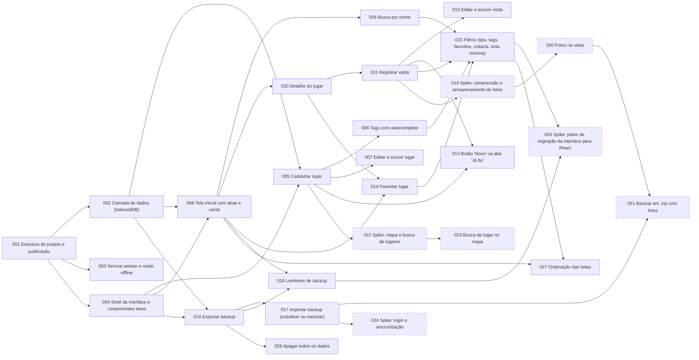

# Cards — Diário de Rolê

**Fonte:** [refinamento.md](../refinamento.md), refinamento de 07/11/2026 ([versão online](https://claude.ai/artifact/2yiGmKhPdsJ64BNrgEHpag)). Atualizado em 08/11/2026 com o RF18 (apagar todos os dados → CARD-026) e com o RF19 / RN13–RN16 (ordenação das listas → CARD-027). Atualizado em 13/11/2026: os cards de evolução (CARD-019 a CARD-025) foram descartados.

## Resumo

- **Total:** 27 cards. Os 20 do MVP estão `done`; os 7 de evolução estão `descartado`.
- **Complexidade (MVP):** P 8 · M 12 · G 0.
- **Descartados em 13/11/2026:** CARD-019 a CARD-025 (fotos, mapa, login/sync e React). O app continua 100% local, e esses itens esbarram nesse limite; o motivo de cada um está no [refinamento](../refinamento.md#escopo). Os arquivos ficam como histórico e não devem ser implementados.

## Quadro

| Card | Título | Contexto | Tipo | Compl. | Prioridade | Incerteza | Status | Depende de |
| --- | --- | --- | --- | --- | --- | --- | --- | --- |
| [CARD-001](01-fundacao/CARD-001-estrutura-do-projeto.md) | Estrutura do projeto e publicação | fundacao | setup | M | mvp | baixa | done | — |
| [CARD-002](01-fundacao/CARD-002-camada-de-dados-indexeddb.md) | Camada de dados (IndexedDB) | fundacao | dados | M | mvp | baixa | done | 001 |
| [CARD-003](01-fundacao/CARD-003-service-worker-offline.md) | Service worker e modo offline | fundacao | infra | M | mvp | media | done | 001 |
| [CARD-004](01-fundacao/CARD-004-shell-da-interface.md) | Shell da interface e componentes base | fundacao | setup | M | mvp | baixa | done | 001 |
| [CARD-005](02-lugares/CARD-005-cadastrar-lugar.md) | Cadastrar lugar | lugares | feature | M | mvp | baixa | done | 002, 004 |
| [CARD-006](02-lugares/CARD-006-tags-com-autocomplete.md) | Tags com autocomplete | lugares | feature | P | mvp | baixa | done | 005 |
| [CARD-007](02-lugares/CARD-007-editar-e-excluir-lugar.md) | Editar e excluir lugar | lugares | feature | M | mvp | baixa | done | 005 |
| [CARD-008](03-inicio/CARD-008-tela-inicial-com-abas.md) | Tela inicial com abas e cards | inicio | feature | M | mvp | baixa | done | 002, 004 |
| [CARD-009](03-inicio/CARD-009-busca-por-nome.md) | Busca por nome | inicio | feature | P | mvp | baixa | done | 008 |
| [CARD-010](04-detalhe-e-visitas/CARD-010-detalhe-do-lugar.md) | Detalhe do lugar | detalhe-visitas | feature | M | mvp | baixa | done | 008 |
| [CARD-011](04-detalhe-e-visitas/CARD-011-registrar-visita.md) | Registrar visita | detalhe-visitas | feature | M | mvp | baixa | done | 010 |
| [CARD-012](04-detalhe-e-visitas/CARD-012-editar-e-excluir-visita.md) | Editar e excluir visita | detalhe-visitas | feature | P | mvp | baixa | done | 011 |
| [CARD-013](04-detalhe-e-visitas/CARD-013-novo-na-aba-ja-fui.md) | Botão "Novo" na aba "Já fui" | detalhe-visitas | feature | P | mvp | baixa | done | 005, 011 |
| [CARD-014](05-favoritos-e-filtros/CARD-014-favoritar-lugar.md) | Favoritar lugar | descoberta | feature | P | mvp | baixa | done | 008, 010 |
| [CARD-015](05-favoritos-e-filtros/CARD-015-filtros.md) | Filtros (tipo, tags, favoritos, voltaria, nota mínima) | descoberta | feature | M | mvp | baixa | done | 006, 009, 011, 014 |
| [CARD-016](06-backup/CARD-016-exportar-backup.md) | Exportar backup | backup | feature | P | mvp | baixa | done | 002, 004 |
| [CARD-017](06-backup/CARD-017-importar-backup.md) | Importar backup (substituir ou mesclar) | backup | feature | M | mvp | media | done | 016 |
| [CARD-018](06-backup/CARD-018-lembrete-de-backup.md) | Lembrete de backup | backup | feature | P | mvp | baixa | done | 008, 016 |
| [CARD-019](07-evolucao/CARD-019-spike-fotos.md) | Spike: compressão e armazenamento de fotos | evolucao | spike | P | depois | media | descartado | 011 |
| [CARD-020](07-evolucao/CARD-020-fotos-na-visita.md) | Fotos na visita | evolucao | feature | M | depois | media | descartado | 019 |
| [CARD-021](07-evolucao/CARD-021-backup-zip-com-fotos.md) | Backup em .zip com fotos | evolucao | feature | M | depois | media | descartado | 017, 020 |
| [CARD-022](07-evolucao/CARD-022-spike-mapa.md) | Spike: mapa e busca de lugares | evolucao | spike | P | depois | alta | descartado | 005 |
| [CARD-023](07-evolucao/CARD-023-busca-de-lugar-no-mapa.md) | Busca de lugar no mapa | evolucao | integracao | M | depois | media | descartado | 022 |
| [CARD-024](07-evolucao/CARD-024-spike-login-e-sync.md) | Spike: login e sincronização | evolucao | spike | P | depois | alta | descartado | 017 |
| [CARD-025](07-evolucao/CARD-025-spike-migracao-react.md) | Spike: plano de migração da interface para React | evolucao | spike | P | depois | media | descartado | 015, 018 |
| [CARD-026](06-backup/CARD-026-apagar-todos-os-dados.md) | Apagar todos os dados | backup | feature | P | mvp | baixa | done | 016 |
| [CARD-027](05-favoritos-e-filtros/CARD-027-ordenacao-das-listas.md) | Ordenação das listas | descoberta | feature | M | mvp | baixa | done | 008, 015 |

## Ordem sugerida de execução

Cards da mesma onda podem rodar em paralelo.

**MVP**

1. CARD-001 (Estrutura do projeto e publicação)
2. CARD-002 (Camada de dados (IndexedDB)), CARD-003 (Service worker e modo offline), CARD-004 (Shell da interface e componentes base)
3. CARD-005 (Cadastrar lugar), CARD-008 (Tela inicial com abas e cards), CARD-016 (Exportar backup)
4. CARD-006 (Tags com autocomplete), CARD-007 (Editar e excluir lugar), CARD-009 (Busca por nome), CARD-010 (Detalhe do lugar), CARD-017 (Importar backup (substituir ou mesclar)), CARD-018 (Lembrete de backup), CARD-026 (Apagar todos os dados)
5. CARD-011 (Registrar visita), CARD-014 (Favoritar lugar)
6. CARD-012 (Editar e excluir visita), CARD-013 (Botão "Novo" na aba "Já fui"), CARD-015 (Filtros (tipo, tags, favoritos, voltaria, nota mínima))
7. CARD-027 (Ordenação das listas), incluído depois da entrega do MVP

**Evolução:** não há ondas. CARD-019 a CARD-025 foram descartados em 13/11/2026.

## Grafo de dependências

Cards tracejados foram descartados.

## Rastreabilidade

| Requisito | Cards |
| --- | --- |
| RF01 | CARD-005, CARD-013 |
| RF02 | CARD-007 |
| RF03 | CARD-007 |
| RF04 | CARD-011, CARD-013 |
| RF05 | CARD-012 |
| RF06 | CARD-010 |
| RF07 | CARD-014 |
| RF08 | CARD-008 |
| RF09 | CARD-009 |
| RF10 | CARD-015 |
| RF11 | CARD-006 |
| RF12 | CARD-016 (CARD-021 descartado) |
| RF13 | CARD-017 (CARD-021 descartado) |
| RF14 | CARD-018 |
| RF15 | Descartado (CARD-019, CARD-020, CARD-021) |
| RF16 | Descartado (CARD-022, CARD-023) |
| RF17 | Descartado (CARD-024) |
| RF18 | CARD-026 |
| RF19 | CARD-027 |
| RN01 | CARD-005 |
| RN02 | CARD-005 |
| RN03 | CARD-006 |
| RN04 | CARD-011, CARD-012 |
| RN05 | CARD-011, CARD-012 |
| RN06 | CARD-002, CARD-007 |
| RN07 | CARD-015 |
| RN08 | CARD-008, CARD-010, CARD-015 |
| RN09 | CARD-014 |
| RN10 | CARD-005, CARD-007 |
| RN11 | CARD-017 |
| RN12 | CARD-018 |
| RN13 | CARD-027 |
| RN14 | CARD-027 |
| RN15 | CARD-027 |
| RN16 | CARD-027 |
| RNF Plataforma (PWA instalável, HTTPS) | CARD-001, CARD-003 |
| RNF Offline | CARD-003 |
| RNF Armazenamento (IndexedDB persistente) | CARD-002 |
| RNF Durabilidade (backup) | CARD-016, CARD-018 |
| RNF Performance (< 200 ms, referência) | CARD-008, CARD-009, CARD-015, CARD-027 |
| RNF Privacidade / LGPD | CARD-001 |
| RNF Usabilidade (mobile-first) | CARD-004 |
| RNF Custo zero | CARD-001 |
| Migração para React | Descartado (CARD-025) |

## Premissas assumidas

Detalhes de implementação que o refinamento não fixou e foram decididos na quebra dos cards:

- Ordenação das listas: "Quero ir" pelo cadastro mais recente; "Já fui" pela última visita mais recente, com lugares sem visitas no fim (CARD-008). Essa passou a ser a ordem padrão das opções do CARD-027 (RN13–RN15).
- A ordem escolhida não vai para a URL: fica em `meta.homeSort` e é lida a cada render da tela inicial (CARD-027).
- A busca ignora maiúsculas e acentos, e o termo continua aplicado ao trocar de aba (CARD-009).
- Filtros: OU entre opções do mesmo critério, E entre critérios diferentes (CARD-015).
- No fluxo "Novo" da aba "Já fui", sair sem salvar a visita deixa o lugar em "Quero ir" (CARD-013).
- No import com "mesclar", as visitas de um lugar ignorado por nome duplicado também são ignoradas, para não gerar visitas órfãs (CARD-017).
- "Depois" no lembrete de backup esconde o banner até a próxima abertura do app (CARD-018).
- "Apagar todos os dados" limpa lugares, visitas e `lastExportAt`, mas mantém `schemaVersion` e `persistentStorage`. A confirmação tem dois passos e não existe desfazer: para voltar atrás, é preciso importar um backup (CARD-026).
- Testes automatizados são opcionais; as funções puras de `services/` podem ser testadas com `node --test`.

## Perguntas em aberto

Nenhuma. Não há cards pendentes.
