# Cards — Diário de Rolê

**Fonte:** [refinamento.md](../refinamento.md), refinamento de 07/11/2026 ([versão online](https://claude.ai/artifact/2yiGmKhPdsJ64BNrgEHpag)).
- **08/11/2026:** entraram o RF18 (apagar todos os dados → CARD-026) e o RF19 / RN13–RN16 (ordenação das listas → CARD-027).
- **13/11/2026:** os cards de evolução CARD-019 a CARD-025 foram descartados, e entraram os cards da **evolução 1.1–1.4** (RF20–RF33, RN17–RN30 → CARD-028 a CARD-040).

## Resumo

- **Total:** 40 cards.
  - Os 20 do MVP estão `done`.
  - Os 7 de evolução antiga estão `descartado`.
  - Os 13 da evolução 1.1–1.4 estão `todo`.
- **Complexidade:**
  - MVP: P 8 · M 12 · G 0.
  - Evolução 1.1–1.4: P 1 · M 12 · G 0.
- **Modelo sugerido (evolução 1.1–1.4):** opus 2 (CARD-028, CARD-034) · sonnet 11 · haiku 0. Os cards do MVP não têm `modelo_sugerido`, porque já foram implementados.
- **Precisam de atenção:**
  - O CARD-031 tem uma decisão pendente: o tipo do arquivo compartilhado (o `.json` pode não ser aceito pelo Chrome Android).
  - Os cards com incerteza média são CARD-028, CARD-030, CARD-031, CARD-034 e CARD-038.
- **Descartados em 13/11/2026:** CARD-019 a CARD-025 (fotos, mapa, login/sync e React). O app continua 100% local, e esses itens esbarram nesse limite; o motivo de cada um está no [refinamento](../refinamento.md#escopo). Os arquivos ficam como histórico e não devem ser implementados.

## Fluxo de git

- **Fluxo:** `branch-por-card`, definido no [CLAUDE.md](../../CLAUDE.md#git-workflow-and-subagents), que prevalece sobre este arquivo.
- **Branches:**
  - **de integração:** `dev`;
  - **estável:** `main` (publicada no GitHub Pages; só recebe a `dev` numa release, quando o usuário pede);
  - **de cada card:** `card/<id>-<slug>`, criada a partir da `dev`.
- **Merge:** direto, com `git merge --no-ff`, sem pull request.
- **Commits:** em português, no formato `feat: <o que mudou> (CARD-XXX)`, `fix: …` ou `docs: …`.
- **Status:** `todo` → `done`, conforme o CLAUDE.md. A orquestradora marca `done` depois do merge na `dev`, e o usuário valida pelos critérios de aceite.

## Quadro

| Card | Título | Contexto | Tipo | Compl. | Prioridade | Incerteza | Modelo | Status | Depende de |
| --- | --- | --- | --- | --- | --- | --- | --- | --- | --- |
| [CARD-001](01-fundacao/CARD-001-estrutura-do-projeto.md) | Estrutura do projeto e publicação | fundacao | setup | M | mvp | baixa | — | done | — |
| [CARD-002](01-fundacao/CARD-002-camada-de-dados-indexeddb.md) | Camada de dados (IndexedDB) | fundacao | dados | M | mvp | baixa | — | done | 001 |
| [CARD-003](01-fundacao/CARD-003-service-worker-offline.md) | Service worker e modo offline | fundacao | infra | M | mvp | media | — | done | 001 |
| [CARD-004](01-fundacao/CARD-004-shell-da-interface.md) | Shell da interface e componentes base | fundacao | setup | M | mvp | baixa | — | done | 001 |
| [CARD-005](02-lugares/CARD-005-cadastrar-lugar.md) | Cadastrar lugar | lugares | feature | M | mvp | baixa | — | done | 002, 004 |
| [CARD-006](02-lugares/CARD-006-tags-com-autocomplete.md) | Tags com autocomplete | lugares | feature | P | mvp | baixa | — | done | 005 |
| [CARD-007](02-lugares/CARD-007-editar-e-excluir-lugar.md) | Editar e excluir lugar | lugares | feature | M | mvp | baixa | — | done | 005 |
| [CARD-008](03-inicio/CARD-008-tela-inicial-com-abas.md) | Tela inicial com abas e cards | inicio | feature | M | mvp | baixa | — | done | 002, 004 |
| [CARD-009](03-inicio/CARD-009-busca-por-nome.md) | Busca por nome | inicio | feature | P | mvp | baixa | — | done | 008 |
| [CARD-010](04-detalhe-e-visitas/CARD-010-detalhe-do-lugar.md) | Detalhe do lugar | detalhe-visitas | feature | M | mvp | baixa | — | done | 008 |
| [CARD-011](04-detalhe-e-visitas/CARD-011-registrar-visita.md) | Registrar visita | detalhe-visitas | feature | M | mvp | baixa | — | done | 010 |
| [CARD-012](04-detalhe-e-visitas/CARD-012-editar-e-excluir-visita.md) | Editar e excluir visita | detalhe-visitas | feature | P | mvp | baixa | — | done | 011 |
| [CARD-013](04-detalhe-e-visitas/CARD-013-novo-na-aba-ja-fui.md) | Botão "Novo" na aba "Já fui" | detalhe-visitas | feature | P | mvp | baixa | — | done | 005, 011 |
| [CARD-014](05-favoritos-e-filtros/CARD-014-favoritar-lugar.md) | Favoritar lugar | descoberta | feature | P | mvp | baixa | — | done | 008, 010 |
| [CARD-015](05-favoritos-e-filtros/CARD-015-filtros.md) | Filtros (tipo, tags, favoritos, voltaria, nota mínima) | descoberta | feature | M | mvp | baixa | — | done | 006, 009, 011, 014 |
| [CARD-016](06-backup/CARD-016-exportar-backup.md) | Exportar backup | backup | feature | P | mvp | baixa | — | done | 002, 004 |
| [CARD-017](06-backup/CARD-017-importar-backup.md) | Importar backup (substituir ou mesclar) | backup | feature | M | mvp | media | — | done | 016 |
| [CARD-018](06-backup/CARD-018-lembrete-de-backup.md) | Lembrete de backup | backup | feature | P | mvp | baixa | — | done | 008, 016 |
| [CARD-019](07-evolucao/CARD-019-spike-fotos.md) | Spike: compressão e armazenamento de fotos | evolucao | spike | P | depois | media | — | descartado | 011 |
| [CARD-020](07-evolucao/CARD-020-fotos-na-visita.md) | Fotos na visita | evolucao | feature | M | depois | media | — | descartado | 019 |
| [CARD-021](07-evolucao/CARD-021-backup-zip-com-fotos.md) | Backup em .zip com fotos | evolucao | feature | M | depois | media | — | descartado | 017, 020 |
| [CARD-022](07-evolucao/CARD-022-spike-mapa.md) | Spike: mapa e busca de lugares | evolucao | spike | P | depois | alta | — | descartado | 005 |
| [CARD-023](07-evolucao/CARD-023-busca-de-lugar-no-mapa.md) | Busca de lugar no mapa | evolucao | integracao | M | depois | media | — | descartado | 022 |
| [CARD-024](07-evolucao/CARD-024-spike-login-e-sync.md) | Spike: login e sincronização | evolucao | spike | P | depois | alta | — | descartado | 017 |
| [CARD-025](07-evolucao/CARD-025-spike-migracao-react.md) | Spike: plano de migração da interface para React | evolucao | spike | P | depois | media | — | descartado | 015, 018 |
| [CARD-026](06-backup/CARD-026-apagar-todos-os-dados.md) | Apagar todos os dados | backup | feature | P | mvp | baixa | — | done | 016 |
| [CARD-027](05-favoritos-e-filtros/CARD-027-ordenacao-das-listas.md) | Ordenação das listas | descoberta | feature | M | mvp | baixa | — | done | 008, 015 |
| [CARD-028](08-v1-1-configuracoes/CARD-028-testes-e-versao-unica.md) | Fundação: testes automatizados e versão única | fundacao-evolucao | setup | M | mvp | media | opus | todo | — |
| [CARD-029](08-v1-1-configuracoes/CARD-029-tela-de-configuracoes.md) | Tela de Configurações | configuracoes | feature | M | mvp | baixa | sonnet | todo | 028 |
| [CARD-030](08-v1-1-configuracoes/CARD-030-tema-escuro.md) | Tema escuro | configuracoes | feature | M | mvp | media | sonnet | todo | 029 |
| [CARD-031](08-v1-1-configuracoes/CARD-031-backup-pelo-compartilhar.md) | Backup pelo compartilhar | configuracoes | feature | P | mvp | media | sonnet | todo | 030 |
| [CARD-032](09-v1-2-sair-de-casa/CARD-032-maps-e-compartilhar-lugar.md) | Abrir no Maps e compartilhar lugar | sair-de-casa | feature | M | mvp | baixa | sonnet | todo | 031 |
| [CARD-033](09-v1-2-sair-de-casa/CARD-033-sortear-e-atalhos.md) | Sortear um lugar e atalhos do ícone | sair-de-casa | feature | M | mvp | baixa | sonnet | todo | 031 |
| [CARD-034](10-v1-3-registros/CARD-034-esquema-v2-e-backup.md) | Esquema v2: campos novos e backup versão 2 | registros | dados | M | mvp | media | opus | todo | 032, 033 |
| [CARD-035](10-v1-3-registros/CARD-035-faixa-de-preco.md) | Faixa de preço no lugar | registros | feature | M | mvp | baixa | sonnet | todo | 034 |
| [CARD-036](10-v1-3-registros/CARD-036-indicado-por-e-link.md) | Indicado por e link do lugar | registros | feature | M | mvp | baixa | sonnet | todo | 035 |
| [CARD-037](10-v1-3-registros/CARD-037-com-quem-e-destaques.md) | Com quem e pedidos/destaques na visita | registros | feature | M | mvp | baixa | sonnet | todo | 036 |
| [CARD-038](10-v1-3-registros/CARD-038-desfazer-exclusao.md) | Desfazer exclusão de visita e de lugar | registros | feature | M | mvp | media | sonnet | todo | 037 |
| [CARD-039](11-v1-4-olhar-para-tras/CARD-039-estatisticas.md) | Estatísticas | olhar-para-tras | feature | M | mvp | baixa | sonnet | todo | 038 |
| [CARD-040](11-v1-4-olhar-para-tras/CARD-040-tags-fixadas.md) | Tags fixadas na tela inicial | olhar-para-tras | feature | M | mvp | baixa | sonnet | todo | 039 |

## Ondas de execução

Cards da mesma onda não dependem um do outro e não editam os mesmos arquivos, então podem rodar em paralelo (fluxo `branch-por-card`). Quando dois cards tocam o mesmo arquivo, eles foram colocados em ondas diferentes, com dependência explícita.

**MVP (concluído)**

1. CARD-001 (Estrutura do projeto e publicação)
2. CARD-002 (Camada de dados (IndexedDB)), CARD-003 (Service worker e modo offline), CARD-004 (Shell da interface e componentes base)
3. CARD-005 (Cadastrar lugar), CARD-008 (Tela inicial com abas e cards), CARD-016 (Exportar backup)
4. CARD-006 (Tags com autocomplete), CARD-007 (Editar e excluir lugar), CARD-009 (Busca por nome), CARD-010 (Detalhe do lugar), CARD-017 (Importar backup (substituir ou mesclar)), CARD-018 (Lembrete de backup), CARD-026 (Apagar todos os dados)
5. CARD-011 (Registrar visita), CARD-014 (Favoritar lugar)
6. CARD-012 (Editar e excluir visita), CARD-013 (Botão "Novo" na aba "Já fui"), CARD-015 (Filtros (tipo, tags, favoritos, voltaria, nota mínima))
7. CARD-027 (Ordenação das listas), incluído depois da entrega do MVP

**Evolução 1.1–1.4**

Cada release do refinamento fecha um grupo de ondas. A release (subir `js/version.js`, escrever o `CHANGELOG.md`, fazer o merge da `dev` na `main` e criar a tag) só acontece quando o usuário pedir. Se o card de uma release seguinte for mesclado na `dev` antes disso, ele vai junto na release.

- **Release v1.1.0, Configurações:**
  - Onda 8: CARD-028 (Fundação: testes e versão única)
  - Onda 9: CARD-029 (Tela de Configurações)
  - Onda 10: CARD-030 (Tema escuro)
  - Onda 11: CARD-031 (Backup pelo compartilhar)
- **Release v1.2.0, Sair de casa:**
  - Onda 12: CARD-032 (Abrir no Maps e compartilhar lugar) ∥ CARD-033 (Sortear e atalhos do ícone). **Podem rodar em paralelo**:
    - o CARD-032 edita `place-detail.js`, `format.js` e `format.test.js`, sem tocar no CSS;
    - o CARD-033 edita `home.js`, `lists.js`, `lists.test.js`, `manifest.webmanifest` e `css/app.css`.
- **Release v1.3.0, Registros mais ricos:**
  - Onda 13: CARD-034 (Esquema v2 e backup)
  - Onda 14: CARD-035 (Faixa de preço)
  - Onda 15: CARD-036 (Indicado por e link)
  - Onda 16: CARD-037 (Com quem e destaques)
  - Onda 17: CARD-038 (Desfazer exclusão)
- **Release v1.4.0, Olhar para trás:**
  - Onda 18: CARD-039 (Estatísticas)
  - Onda 19: CARD-040 (Tags fixadas)

A maior parte da evolução é sequencial porque quase todos os cards passam por `settings.js`, `place-form.js`, `place-detail.js`, `visit-form.js`, `home.js` ou `css/app.css`. Os ícones da evolução inteira foram concentrados no CARD-029, para não criar mais conflitos em `js/ui/icons.js`.

## Grafo de dependências

Cards tracejados foram descartados.

```mermaid
flowchart LR
    C001["001 Estrutura do projeto e publicação"]
    C002["002 Camada de dados (IndexedDB)"]
    C003["003 Service worker e modo offline"]
    C004["004 Shell da interface e componentes base"]
    C005["005 Cadastrar lugar"]
    C006["006 Tags com autocomplete"]
    C007["007 Editar e excluir lugar"]
    C008["008 Tela inicial com abas e cards"]
    C009["009 Busca por nome"]
    C010["010 Detalhe do lugar"]
    C011["011 Registrar visita"]
    C012["012 Editar e excluir visita"]
    C013["013 Botão 'Novo' na aba 'Já fui'"]
    C014["014 Favoritar lugar"]
    C015["015 Filtros (tipo, tags, favoritos, voltaria, nota mínima)"]
    C016["016 Exportar backup"]
    C017["017 Importar backup (substituir ou mesclar)"]
    C018["018 Lembrete de backup"]
    C019["019 Spike: compressão e armazenamento de fotos"]
    C020["020 Fotos na visita"]
    C021["021 Backup em .zip com fotos"]
    C022["022 Spike: mapa e busca de lugares"]
    C023["023 Busca de lugar no mapa"]
    C024["024 Spike: login e sincronização"]
    C025["025 Spike: plano de migração da interface para React"]
    C026["026 Apagar todos os dados"]
    C027["027 Ordenação das listas"]
    C028["028 Fundação: testes e versão única"]
    C029["029 Tela de Configurações"]
    C030["030 Tema escuro"]
    C031["031 Backup pelo compartilhar"]
    C032["032 Abrir no Maps e compartilhar lugar"]
    C033["033 Sortear e atalhos do ícone"]
    C034["034 Esquema v2 e backup"]
    C035["035 Faixa de preço"]
    C036["036 Indicado por e link"]
    C037["037 Com quem e destaques"]
    C038["038 Desfazer exclusão"]
    C039["039 Estatísticas"]
    C040["040 Tags fixadas"]
    C001 --> C002
    C001 --> C003
    C001 --> C004
    C002 --> C005
    C004 --> C005
    C005 --> C006
    C005 --> C007
    C002 --> C008
    C004 --> C008
    C008 --> C009
    C008 --> C010
    C010 --> C011
    C011 --> C012
    C005 --> C013
    C011 --> C013
    C008 --> C014
    C010 --> C014
    C006 --> C015
    C009 --> C015
    C011 --> C015
    C014 --> C015
    C002 --> C016
    C004 --> C016
    C016 --> C017
    C008 --> C018
    C016 --> C018
    C011 --> C019
    C019 --> C020
    C017 --> C021
    C020 --> C021
    C005 --> C022
    C022 --> C023
    C017 --> C024
    C015 --> C025
    C018 --> C025
    C016 --> C026
    C008 --> C027
    C015 --> C027
    C027 --> C028
    C028 --> C029
    C029 --> C030
    C030 --> C031
    C031 --> C032
    C031 --> C033
    C032 --> C034
    C033 --> C034
    C034 --> C035
    C035 --> C036
    C036 --> C037
    C037 --> C038
    C038 --> C039
    C039 --> C040
    classDef descartado stroke-dasharray: 5 5
    class C019,C020,C021,C022,C023,C024,C025 descartado
```



A seta 027 → 028 só indica a ordem: o CARD-028 parte do MVP pronto.

## Rastreabilidade

| Requisito | Cards |
| --- | --- |
| RF01 | CARD-005, CARD-013 |
| RF02 | CARD-007 |
| RF03 | CARD-007, CARD-038 |
| RF04 | CARD-011, CARD-013 |
| RF05 | CARD-012, CARD-038 |
| RF06 | CARD-010 |
| RF07 | CARD-014 |
| RF08 | CARD-008 |
| RF09 | CARD-009 |
| RF10 | CARD-015, CARD-035, CARD-040 |
| RF11 | CARD-006 |
| RF12 | CARD-016, CARD-029 (CARD-021 descartado) |
| RF13 | CARD-017, CARD-029 (CARD-021 descartado) |
| RF14 | CARD-018, CARD-029 |
| RF15 | Descartado (CARD-019, CARD-020, CARD-021) |
| RF16 | Descartado (CARD-022, CARD-023) |
| RF17 | Descartado (CARD-024) |
| RF18 | CARD-026, CARD-029 |
| RF19 | CARD-027 |
| RF20 | CARD-029 |
| RF21 | CARD-030 |
| RF22 | CARD-031 |
| RF23 | CARD-028, CARD-029 |
| RF24 | CARD-032 |
| RF25 | CARD-032 |
| RF26 | CARD-033 |
| RF27 | CARD-033 |
| RF28 | CARD-035 |
| RF29 | CARD-036 |
| RF30 | CARD-037 |
| RF31 | CARD-038 |
| RF32 | CARD-039 |
| RF33 | CARD-040 |
| RN01 | CARD-005 |
| RN02 | CARD-005 |
| RN03 | CARD-006 |
| RN04 | CARD-011, CARD-012, CARD-038 |
| RN05 | CARD-011, CARD-012 |
| RN06 | CARD-002, CARD-007, CARD-038 |
| RN07 | CARD-015 |
| RN08 | CARD-008, CARD-010, CARD-015 |
| RN09 | CARD-014 |
| RN10 | CARD-005, CARD-007 |
| RN11 | CARD-017 |
| RN12 | CARD-018 |
| RN13 | CARD-027 |
| RN14 | CARD-027, CARD-028 (testes) |
| RN15 | CARD-027, CARD-028 (testes) |
| RN16 | CARD-027 |
| RN17 | CARD-030 |
| RN18 | CARD-031 |
| RN19 | CARD-028 |
| RN20 | CARD-032 |
| RN21 | CARD-032, CARD-035, CARD-036 |
| RN22 | CARD-033 |
| RN23 | CARD-034, CARD-035 |
| RN24 | CARD-034, CARD-036, CARD-037 |
| RN25 | CARD-034, CARD-036 |
| RN26 | CARD-037 |
| RN27 | CARD-038 |
| RN28 | CARD-039 |
| RN29 | CARD-034 (backup), CARD-040 |
| RN30 | CARD-034 |
| RNF Plataforma (PWA instalável, HTTPS) | CARD-001, CARD-003 |
| RNF Offline | CARD-003 (e um critério em cada card da evolução) |
| RNF Armazenamento (IndexedDB persistente) | CARD-002 |
| RNF Durabilidade (backup) | CARD-016, CARD-018, CARD-031 |
| RNF Performance (< 200 ms, referência) | CARD-008, CARD-009, CARD-015, CARD-027, CARD-039 |
| RNF Privacidade / LGPD | CARD-001, CARD-032 |
| RNF Usabilidade (mobile-first) | CARD-004 |
| RNF Custo zero | CARD-001 |
| RNF Testes automatizados (evolução) | CARD-028 (e testes em cada card com regra nova) |
| RNF Versão (evolução) | CARD-028 |
| RNF Acessibilidade, tema escuro (evolução) | CARD-030 |
| Migração para React | Descartado (CARD-025) |

## Pendências que não são cards

- **Tag `v1.0.0`:** a orquestradora a cria na `main` atual antes de fazer o merge do CARD-028, como manda o refinamento. O push da tag acontece quando o usuário pedir push.
- **Tipo do arquivo compartilhado (CARD-031):** confirmar no celular se o Chrome Android compartilha `.json`. Se não compartilhar, decidir entre `.json.txt` (recomendado) e manter só o `.json`, antes de delegar.
- **Node local (opcional):** sem Node na máquina, os subagentes não conseguem rodar `node --test`, e os testes só rodam no GitHub Actions depois do push da `dev`. Instalar o Node (`winget install OpenJS.NodeJS.LTS`) permite rodar os testes antes do merge.
- **Releases:** ao fim de cada grupo de ondas (v1.1 a v1.4), quando o usuário pedir.

## Premissas assumidas

Detalhes de implementação que o refinamento não fixou e foram decididos na quebra dos cards:

**MVP**

- **Ordenação das listas:** "Quero ir" pelo cadastro mais recente; "Já fui" pela última visita mais recente, com lugares sem visitas no fim (CARD-008). Essa passou a ser a ordem padrão das opções do CARD-027 (RN13–RN15).
- **Ordem escolhida:** não vai para a URL; fica em `meta.homeSort` e é lida a cada render da tela inicial (CARD-027).
- **Busca:** ignora maiúsculas e acentos, e o termo continua aplicado ao trocar de aba (CARD-009).
- **Filtros:** OU entre opções do mesmo critério, E entre critérios diferentes (CARD-015).
- **"Novo" na aba "Já fui":** sair sem salvar a visita deixa o lugar em "Quero ir" (CARD-013).
- **Import com "mesclar":** as visitas de um lugar ignorado por nome duplicado também são ignoradas, para não gerar visitas órfãs (CARD-017).
- **"Depois" no lembrete de backup:** esconde o banner até a próxima abertura do app (CARD-018).
- **"Apagar todos os dados":** limpa lugares, visitas e `lastExportAt`, mas mantém `schemaVersion` e `persistentStorage` (e, a partir da evolução, `homeSort` e `theme`). A confirmação tem dois passos e não existe desfazer; para voltar atrás, é preciso importar um backup (CARD-026).

**Evolução 1.1–1.4**

- **Testes:** passam a ser obrigatórios para toda regra nova em `services/` (RNF de testes). Rodam com `node --test` no GitHub Actions, e um `package.json` sem dependências (`"type": "module"`) faz o Node ler os módulos (CARD-028).
- **Versão:** é um script clássico (`js/version.js`, `self.APP_VERSION`), carregado pelo `sw.js` com `importScripts` e pela página com `<script>`. A alternativa, o service worker como módulo, foi descartada (CARD-028).
- **CHANGELOG:** os cards não editam o `CHANGELOG.md`; ele é escrito na release (CARD-028).
- **Rota antiga:** `#/backup` redireciona para `#/settings` com `replace` (CARD-029).
- **Tema:** a cópia do tema no `localStorage` (`diario-theme`) serve só para o script do `<head>`; a fonte oficial é `meta.theme` (CARD-030).
- **Funções puras de apresentação:** o texto do compartilhar lugar e o link do Maps ficam em `js/ui/format.js`, que é puro e testável. O CARD-035 e o CARD-036 ampliam esse texto.
- **Sorteio:** a função de sortear fica em `js/services/lists.js`, e o atalho "Sortear" usa `#/?draw=1` (CARD-033).
- **Pessoas e tags fixadas:** os serviços de pessoas (`people.js`) e de tags fixadas (`pinned-tags.js`) são criados no CARD-034, porque o backup precisa deles antes das telas.
- **Limites dos campos:** "Indicado por" até 80 caracteres, "Com quem" até 20 nomes de até 60 caracteres e "Pedidos / destaques" até 500 caracteres (CARD-036, CARD-037).
- **Desfazer:** usa uma cópia em memória e `bulkWrite`, e a tela é redesenhada com um `rerender()` novo no router (CARD-038).

## Perguntas em aberto

Nenhuma que bloqueie o início. A decisão do CARD-031 precisa ser resolvida antes de delegar esse card.

## Como implementar um card

**Regras do projeto prevalecem.** O [CLAUDE.md](../../CLAUDE.md) define o fluxo de status (`todo` → `done`), a política de testes, os commits e os padrões de código, e vale sobre estas instruções e sobre o card.

**Card sem `modelo_sugerido`** (os do MVP, já feitos): a sessão principal implementaria direto, seguindo o card.

**Card com `modelo_sugerido`: sessão principal (orquestradora)**
1. Lê o card e confere se os cards de `depende_de` já estão mesclados na `dev`. Se houver Pendências que não são cards (decisões, acessos), resolve com o usuário antes de delegar, porque o subagente não consegue perguntar.
2. Chama um subagente com a ferramenta Agent, tipo `general-purpose`, com `isolation: "worktree"` e `model` igual ao `modelo_sugerido`, usando o modelo de prompt abaixo. Com mais de um card na mesma onda, roda os subagentes em segundo plano.
3. Ao receber o relatório, revisa `git diff dev...card/<id>-<slug>` contra o Detalhamento técnico, o Fora do escopo e os Critérios de aceite. Ajustes vão para o **mesmo** subagente (SendMessage), que continua commitando na mesma branch.
4. Se o subagente devolver perguntas, leva-as ao usuário e retoma o mesmo subagente com as respostas.
5. Faz o merge na `dev`, um card por vez, com `git merge --no-ff`. A partir do segundo card de uma onda, primeiro mescla a `dev` na branch do card e testa de novo.
6. Depois do merge, muda o `status` para `done` (no card e neste quadro) num commit na `dev`, remove a branch e a worktree do card e informa ao usuário o que foi feito, o resultado dos testes e o que ele deve validar pelos critérios de aceite.
7. Não faz push e não mexe na `main` sem o usuário pedir.

**Subagente (implementador)**
- Lê o CLAUDE.md, o card, as premissas deste `_index.md` e os arquivos e seções de Referências.
- Implementa dentro do escopo; o Fora do escopo é obrigatório.
- Não muda o `status` e não marca os checkboxes dos critérios (eles são do usuário).
- Commita só na própria branch do card. Nunca mescla, não faz rebase da `dev`, não faz push e não cria tags.
- Diante de uma decisão que cabe ao usuário, deixa essa parte de lado e devolve a pergunta.
- Relatório final: branch e commits, arquivos alterados, cada critério de aceite com a forma como foi atendido, testes rodados e resultado, desvios do card com o motivo, e perguntas em aberto.

### Modelo de prompt do subagente

As lacunas entre chaves são preenchidas pela orquestradora a cada card.

```text
Você vai implementar o card {ID_DO_CARD} — {TITULO} do projeto Diário de Rolê.

Você roda como subagente: não tem acesso à conversa com o usuário, não consegue fazer perguntas a ele durante o trabalho e só devolve um relatório no fim. Tudo de que precisa está nos arquivos abaixo.

Leia antes de começar, nesta ordem:
1. CLAUDE.md (raiz do repositório) — as regras do projeto prevalecem sobre este prompt e sobre o card (fluxo de status, política de testes, commits, padrões de código, service worker).
2. O card: docs/cards/{PASTA}/{ARQUIVO_DO_CARD}
3. Premissas e perguntas em aberto: docs/cards/_index.md
4. Referências do card: {ARQUIVOS_E_SECOES} (os RF/RN citados estão em docs/refinamento.md)

Contexto adicional da orquestradora: {DECISOES_TOMADAS_COM_O_USUARIO_OU_"Nenhum"}

Regras:
- Implemente apenas o que o card pede. O Fora do escopo é obrigatório.
- Siga o Detalhamento técnico. Se precisar desviar, faça o mínimo necessário e explique no relatório.
- Escreva e rode os testes automatizados de "Como testar" (node --test). Se o Node não estiver instalado, escreva os testes mesmo assim e diga no relatório que eles não rodaram localmente (o GitHub Actions roda depois do push).
- Para conferir no navegador, sirva o app num localhost na porta {8000 + NÚMERO_DO_CARD} e use o Chrome headless, com um perfil novo num caminho curto (ex.: %LOCALAPPDATA%\Temp\cp-{NÚMERO_DO_CARD}).
- Não altere o status do card nem o quadro do _index.md, e não marque os checkboxes dos Critérios de aceite.
- Você está numa worktree própria. Trabalhe na branch card/{ID}-{SLUG}, criada a partir de dev. Não há dependências para instalar nem arquivos fora do git para copiar. Não mexa em CACHE_VERSION nem em js/version.js; inclua todo arquivo novo do app em ASSETS do sw.js. Commite só nessa branch, com mensagens no formato "feat: <o que mudou> ({ID})" (ou fix:/docs:). Não mescle, não faça rebase da dev, não faça push e não crie tags.
- Se surgir uma decisão que cabe ao usuário (regra de negócio, escolha de produto, algo que o card não define), não chute: deixe essa parte de lado, conclua o que não depende dela e devolva a pergunta no relatório.

Relatório final, nesta estrutura:
1. Branch e commits
2. Arquivos criados ou alterados
3. Critérios de aceite: cada um e como foi atendido (ou por que não foi)
4. Testes: o que foi escrito, comando rodado e resultado
5. Desvios do Detalhamento técnico, com o motivo
6. Perguntas em aberto para o usuário
```

Exceção do CARD-028: ele cria o próprio `js/version.js` e muda a forma como o `CACHE_VERSION` é montado. Nesse card, troque a frase "Não mexa em CACHE_VERSION nem em js/version.js" por "Siga o card sobre js/version.js e CACHE_VERSION".
