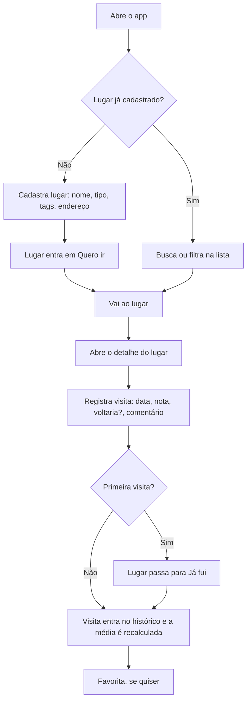
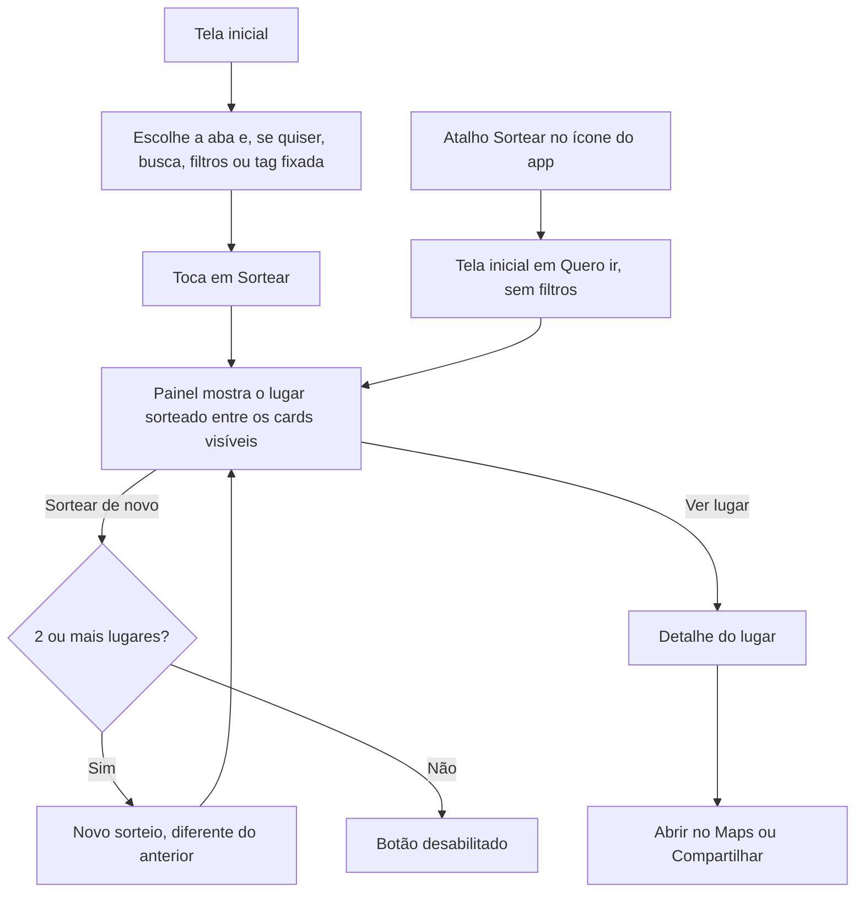
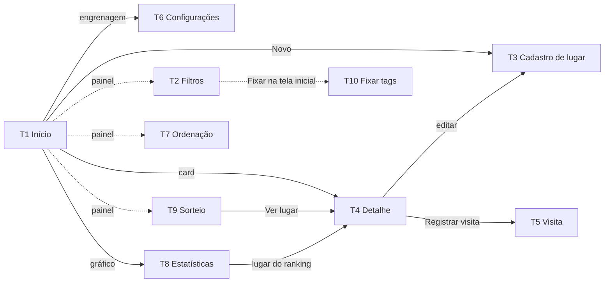
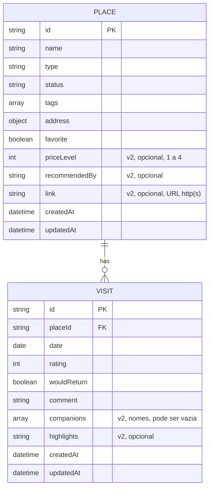
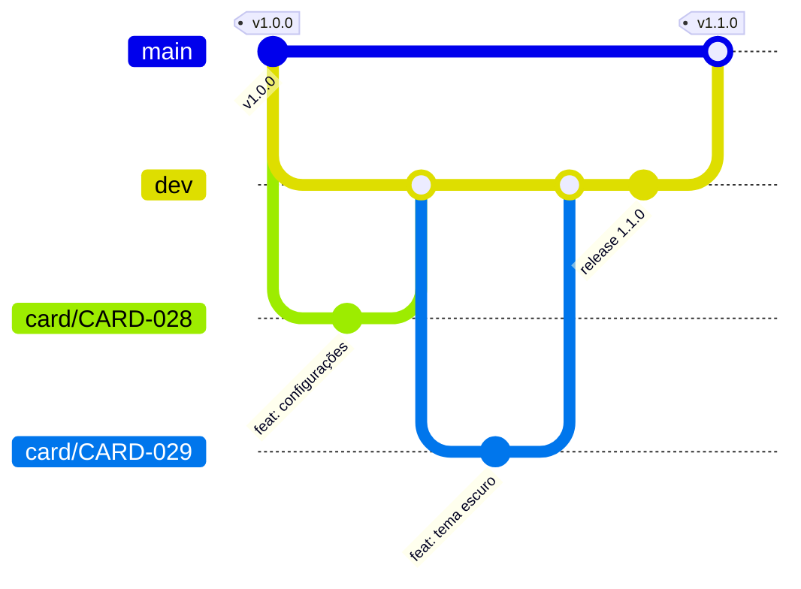

# Refinamento — Diário de Rolê

07/11/2026 · Thales Alves · [versão online](https://claude.ai/artifact/2yiGmKhPdsJ64BNrgEHpag)
Atualizado em 08/11/2026: ordenação das listas (RF19, RN13–RN16, T7). Atualizado em 13/11/2026: fotos, mapa, login/sync e React descartados (RF15–RF17); evolução 1.1–1.4 em quatro ondas (RF20–RF33, RN17–RN30, RNF de testes e versão, T6 renomeada para Configurações e T8–T10 novas, modelo de dados v2, organização do repositório). Atualizado em 14/11/2026: o backup compartilhado vai como `.json.txt` (RN18). A versão online não tem essas atualizações.

## Visão geral

O Diário de Rolê é um PWA pessoal e offline para guardar os lugares que você quer conhecer e o histórico de cada visita. No MVP não tem publicação, login nem servidor: tudo fica no celular, com backup por exportação.

- **Problema:** indicações e visitas a bares e restaurantes se perdem entre notas, prints e memória. Não existe um lugar só pra lembrar onde ir e o que achou de cada um.
- **Solução:** uma lista "Quero ir" que vira "Já fui" quando a primeira visita é registrada. Cada visita guarda data, nota, "voltaria?" e comentário.
- **Público:** um único usuário (uso próprio), em celular Android.
- **Proposta de valor:** responder rápido "onde a gente vai hoje?" com dados próprios, sem depender de app de terceiros e sem custo de loja.
- **Métricas de sucesso (sugestão):** registrar uma visita em menos de 1 minuto; filtrar "lugares que gostei" em até 3 toques; nenhum dado perdido, com backup exportado ao menos uma vez por mês.

**Evolução 1.1–1.4 (13/11/2026).** Com o MVP em uso, o app ganha melhorias que continuam 100% locais:
- uma tela de Configurações, com tema escuro, backup enviado direto para o Drive ou o WhatsApp e a versão do app;
- atalhos para sair de casa: abrir no Maps, compartilhar um lugar e sortear onde ir;
- registros mais ricos: preço, quem indicou, link, com quem foi e o que pediu;
- uma forma de olhar para trás (estatísticas) e de organizar listas por tags fixadas.

Nada disso exige servidor. "Abrir no Maps" e "Compartilhar" só passam dados para outro app do Android, por ação do usuário.

## Escopo

O MVP cobre cadastro manual, visitas, filtros e backup em JSON. Foto, mapa e login foram descartados em 13/11/2026: o app continua 100% local.

**Entra no MVP**

- Cadastro manual de lugar: nome, tipo (lista fixa), tags livres e endereço em campos separados
- Status "Quero ir" / "Já fui", que muda sozinho na primeira visita
- Várias visitas por lugar: data, nota de 1 a 5, "voltaria?" e comentário
- Favoritar lugar
- Abas "Quero ir" e "Já fui", com busca por nome e filtros por tipo, tag, favoritos, "voltaria" e nota mínima
- Ordenação de cada aba (nome, data de adição, última visita, nota, nº de visitas), lembrada por aba. Incluída em 08/11/2026, depois da entrega do MVP
- Exportar e importar dados em JSON, com lembrete de backup
- Apagar todos os dados do aparelho, com confirmação dupla
- App instalável na tela inicial, funcionando 100% offline

**Evolução 1.1–1.4 (13/11/2026)**

Quatro ondas, cada uma fechada numa release (ver [Organização do repositório](#organização-do-repositório)):

| Onda | Versão | O que entra |
| --- | --- | --- |
| 1 | v1.1.0 | Fundação: testes automatizados no GitHub Actions e versão do app numa constante única. Tela de Configurações (Aparência, Backup, Dados, Sobre) no lugar da tela de Backup; tema escuro; backup pelo compartilhar; versão do app visível |
| 2 | v1.2.0 | Abrir no Maps; compartilhar lugar; sortear um lugar; atalhos no ícone do app |
| 3 | v1.3.0 | Faixa de preço (com filtro); "Indicado por"; link do lugar; "Com quem" e "Pedidos / destaques" na visita; desfazer exclusão |
| 4 | v1.4.0 | Estatísticas; tags fixadas na tela inicial |

**Fica para depois (evolução)**

- Filtrar por pessoa ("Com quem") na tela inicial. Por ora, as pessoas aparecem no histórico e nas estatísticas.
- Tela de novidades da versão dentro do app. O registro das mudanças fica no `CHANGELOG.md`.

**Descartado (13/11/2026)**

Estes itens estavam planejados para depois do MVP. Foram descartados porque esbarram nos limites de um app 100% local, sem servidor e sem chamadas externas. Se voltarem, devem vir num projeto novo, não nesta arquitetura.

- Fotos nas visitas: pesam no armazenamento do celular e no backup (RF15).
- Mapa e busca de lugares: dependem de chamadas externas e, no Google Places, de chave e custo (RF16).
- Login e sincronização entre aparelhos: exigem servidor (RF17). O mesmo vale para grupos de listas compartilhados e colaboração, avaliados em 13/11/2026.
- Migração da interface para React: acrescenta etapa de build e dependências, com pouco ganho para um app pessoal que já funciona.

**Não-objetivos**

- Rede social, perfis ou avaliações públicas
- Publicação em loja (Play Store / App Store)
- Suporte garantido a iPhone

## Requisitos funcionais

São 16 requisitos no MVP, 3 descartados e 14 da evolução 1.1–1.4, no formato ação → resposta do sistema. O RF19 foi incluído em 08/11/2026, depois da entrega do MVP. Na coluna Prioridade, os requisitos da evolução mostram a versão em que entram.

| ID | Requisito (ação → resposta) | Prioridade |
| --- | --- | --- |
| RF01 | Cadastrar lugar com nome, tipo, tags e endereço → salva com status "Quero ir" e mostra na aba correspondente | MVP |
| RF02 | Editar lugar → salva as alterações e atualiza listas e detalhe | MVP |
| RF03 | Excluir lugar → pede confirmação e remove o lugar junto com suas visitas | MVP |
| RF04 | Registrar visita em um lugar (data, nota, voltaria?, comentário) → salva ligada ao lugar; se for a primeira, o lugar passa para "Já fui" | MVP |
| RF05 | Editar ou excluir visita → atualiza histórico e média; o status do lugar não muda | MVP |
| RF06 | Abrir detalhe do lugar → mostra dados, média das notas, última visita e histórico (mais recente primeiro) | MVP |
| RF07 | Favoritar / desfavoritar lugar → alterna o coração na lista e no detalhe | MVP |
| RF08 | Abrir o app → mostra as abas "Quero ir" e "Já fui" com os lugares em cards | MVP |
| RF09 | Digitar na busca → filtra a aba atual por nome enquanto digita | MVP |
| RF10 | Aplicar filtros (tipo, tags, só favoritos, voltaria = sim, nota mínima; preço a partir da v1.3, ver RF28) → mostra só os lugares que atendem a todos | MVP |
| RF11 | Digitar uma tag no cadastro → sugere tags existentes e cria a nova se não existir | MVP |
| RF12 | Exportar dados → baixa um arquivo JSON com todos os lugares e visitas | MVP |
| RF13 | Importar arquivo JSON → valida e pergunta se deve substituir tudo ou mesclar | MVP |
| RF14 | Abrir o app muito tempo após o último export → exibe lembrete de backup | MVP |
| RF15 | Anexar fotos à visita → comprime e salva junto da visita | Descartado |
| RF16 | Buscar lugar no mapa → preenche nome, endereço e localização | Descartado |
| RF17 | Entrar com conta → sincroniza dados entre aparelhos | Descartado |
| RF18 | Apagar todos os dados → mostra o que será apagado e a data do último backup, pede confirmação dupla e remove todos os lugares e visitas | MVP |
| RF19 | Escolher a ordenação na aba atual → reordena a lista na hora e lembra a escolha daquela aba ao reabrir o app | MVP |
| RF20 | Tocar na engrenagem da tela inicial (ou em "Exportar" no lembrete de backup) → abre Configurações, com as seções Aparência, Backup, Dados e Sobre | v1.1 |
| RF21 | Escolher o tema (Automático, Claro ou Escuro) → aplica na hora e mantém a escolha ao reabrir o app | v1.1 |
| RF22 | Tocar em "Compartilhar" no backup → gera o arquivo de backup e abre o menu de compartilhar do Android | v1.1 |
| RF23 | Abrir Configurações → a seção Sobre mostra a versão do app ("Versão 1.1.0") | v1.1 |
| RF24 | Tocar em "Abrir no Maps" no detalhe do lugar → abre o Google Maps buscando o nome e o endereço do lugar | v1.2 |
| RF25 | Tocar em compartilhar no detalhe do lugar → abre o menu de compartilhar do Android com um texto que descreve o lugar | v1.2 |
| RF26 | Tocar em "Sortear" na tela inicial → escolhe ao acaso um dos lugares visíveis na aba e o mostra num painel com "Ver lugar" e "Sortear de novo" | v1.2 |
| RF27 | Segurar o ícone do app e escolher um atalho → "Novo lugar" abre o cadastro; "Sortear" abre a tela inicial em "Quero ir" já com o sorteio | v1.2 |
| RF28 | Informar a faixa de preço do lugar ($ a $$$$) → aparece no card e no detalhe e pode ser usada como filtro | v1.3 |
| RF29 | Informar "Indicado por" e um link no lugar → sugere nomes já usados, completa o link e, no detalhe, mostra os dois; o link abre ao toque | v1.3 |
| RF30 | Informar "Com quem" e "Pedidos / destaques" na visita → sugere nomes já usados e mostra os dois no histórico do lugar | v1.3 |
| RF31 | Excluir uma visita ou um lugar → mostra o aviso "… excluído · Desfazer" por alguns segundos; desfazer devolve o que foi excluído | v1.3 |
| RF32 | Tocar no ícone de gráfico da tela inicial → abre Estatísticas do período escolhido ("Este ano" ou "Tudo") | v1.4 |
| RF33 | Fixar uma tag → ela vira um atalho (chip) no topo da tela inicial; tocar no chip liga ou desliga o filtro daquela tag | v1.4 |

**Critérios de aceite**

- **RF04 — primeira visita**
  - Dado um lugar em "Quero ir" sem visitas
  - Quando registro uma visita com data, nota e "voltaria?"
  - Então a visita aparece no histórico e o lugar sai de "Quero ir" e aparece em "Já fui"
- **RF10 — lugares que gostei**
  - Dado que existem lugares em "Já fui" com notas e respostas diferentes
  - Quando ativo "voltaria = sim" e nota mínima 4
  - Então só aparecem lugares cuja última visita tem "voltaria = sim" e cuja média é 4 ou mais
- **RF13 — importar mesclando**
  - Dado um backup com lugares que já existem no app (mesmo ID)
  - Quando importo escolhendo "mesclar"
  - Então nenhum lugar é duplicado e, em conflito, fica a versão editada mais recentemente
- **RF13 — arquivo inválido**
  - Dado um arquivo que não é um backup do app
  - Quando tento importar
  - Então o app mostra erro e nenhum dado existente é alterado
- **RF19 — onde não vou há tempos**
  - Dado lugares em "Já fui" com visitas em datas diferentes e um lugar sem nenhuma visita
  - Quando escolho "Última visita mais antiga"
  - Então o lugar com a última visita mais antiga aparece primeiro e o lugar sem visitas fica no fim
- **RF19 — ordem lembrada por aba**
  - Dado que escolhi "A–Z" em "Quero ir" e "Maior nota" em "Já fui"
  - Quando fecho e reabro o app
  - Então cada aba continua na ordem que escolhi para ela
- **RF19 — ordem não é filtro**
  - Dado filtros ativos e a ordem "Mais visitados"
  - Quando toco em "Limpar filtros"
  - Então os filtros são removidos, a ordem continua "Mais visitados" e o indicador de filtros não conta a ordem
- **RF21 — tema automático**
  - Dado o tema "Automático" e o celular no modo escuro
  - Quando abro o app
  - Então ele já abre escuro, sem piscar claro antes, e muda junto se eu trocar o modo do celular
- **RF22 — backup enviado**
  - Dado que toco em "Compartilhar" e escolho o Google Drive
  - Quando o envio é concluído
  - Então a data do último backup passa a ser hoje; se eu fechar o menu sem escolher nada, a data não muda
- **RF26 — sortear entre os que eu gostei**
  - Dado "Já fui" com os filtros "voltaria = sim" e nota mínima 4, mostrando 3 lugares
  - Quando toco em "Sortear" e depois em "Sortear de novo"
  - Então os dois resultados estão entre esses 3 lugares e o segundo é diferente do primeiro
- **RF31 — desfazer exclusão de lugar**
  - Dado um lugar com 2 visitas
  - Quando confirmo a exclusão e toco em "Desfazer" no aviso
  - Então o lugar volta com as 2 visitas, no mesmo status, com os mesmos dados de antes
- **RF33 — tag fixada**
  - Dado que fixei a tag "com a dona"
  - Quando toco no chip "com a dona" na tela inicial
  - Então a lista mostra só os lugares com essa tag, o indicador de filtros conta 1, e a tag aparece marcada no painel de filtros

## Regras de negócio

O status do lugar muda sozinho para "Já fui" na primeira visita e nunca volta automaticamente.

- **RN01** — Nome e tipo são obrigatórios no lugar; tags e endereço são opcionais. O endereço tem campos separados: logradouro, número, complemento, bairro, cidade e UF, todos opcionais.
- **RN02** — Tipo vem de lista fixa: Bar, Restaurante, Pizzaria, Hamburgueria, Café, Lanchonete, Balada, Outro.
- **RN03** — Tags são livres e um lugar pode ter várias. Não diferenciam maiúsculas ("BH" e "bh" são a mesma tag).
- **RN04** — Todo lugar nasce em "Quero ir" e passa para "Já fui" ao registrar a primeira visita. Excluir visitas, inclusive a última, apaga só o registro: o lugar continua em "Já fui".
- **RN05** — Na visita, data, nota e "voltaria?" são obrigatórios; comentário é opcional. A data não pode ser futura e a nota é inteira, de 1 a 5.
- **RN06** — Cada visita pertence a exatamente um lugar. Excluir um lugar exclui todas as suas visitas.
- **RN07** — O filtro "voltaria = sim" olha a visita mais recente do lugar.
- **RN08** — A média do lugar considera todas as visitas, com uma casa decimal. O filtro de nota mínima usa essa média. Um lugar em "Já fui" sem visitas fica de fora dos filtros de nota e "voltaria".
- **RN09** — Favorito é independente de nota e de status.
- **RN10** — Não é permitido cadastrar dois lugares com o mesmo nome; a comparação ignora maiúsculas e espaços nas pontas.
- **RN11** — Import só aceita arquivos do app com versão de esquema compatível. "Substituir" apaga tudo antes, com confirmação; "mesclar" casa pelo ID e, em conflito, mantém o registro com data de atualização mais recente. Lugar do arquivo com nome já existente e ID diferente não é importado e aparece listado no resultado.
- **RN12** — O lembrete de backup aparece após 30 dias sem exportar, ou se nunca houve export e já existem dados.
- **RN13** — Opções de ordenação por aba. Em "Quero ir": Adicionados mais recentes (padrão), Adicionados mais antigos e A–Z. Em "Já fui": Última visita mais recente (padrão), Última visita mais antiga, A–Z, Maior nota e Mais visitados. As opções de visita, nota e quantidade não existem em "Quero ir".
- **RN14** — Em "Já fui", lugares sem visitas ficam sempre no fim nas ordens por última visita, nota e nº de visitas, inclusive em "Última visita mais antiga". Entre eles vale "adicionados mais recentes". "Maior nota" usa a média com uma casa decimal (RN08), a mesma que aparece no card.
- **RN15** — Desempate: em data de visita, nota ou nº de visitas, vence a última visita mais recente e depois o nome (A–Z); em data de adição, o nome (A–Z); em A–Z, o adicionado mais recentemente. A ordem alfabética ignora maiúsculas e acentos e segue o português ("Árvore" fica junto de "Arvore").
- **RN16** — A ordem é aplicada depois da busca e dos filtros e não é um filtro: não entra no indicador de filtros ativos, e "Limpar" / "Limpar filtros" não a alteram. Cada aba guarda a sua ordem no aparelho. A ordem não entra no backup e não é apagada por "Apagar todos os dados". Um valor salvo inválido ou desconhecido volta ao padrão da aba.

**Evolução 1.1–1.4**

- **RN17** — Tema: "Automático" (padrão), "Claro" ou "Escuro". "Automático" segue o modo do celular e muda junto com ele. A escolha fica salva no aparelho e vale desde a abertura do app, sem piscar o tema errado. Não entra no backup e não é apagada por "Apagar todos os dados".
- **RN18** — O backup compartilhado tem o mesmo conteúdo do "Baixar arquivo", mas vai como texto: `diario-de-role-AAAA-MM-DD.json.txt` (`text/plain`), porque o Chrome para Android não compartilha `.json` (decidido em 14/11/2026). O "Importar" aceita também `.txt`. A data do último backup (RN12) só é atualizada quando o compartilhamento é concluído; cancelar o menu não muda nada. Se o navegador não suportar compartilhar arquivos, o botão "Compartilhar" não aparece.
- **RN19** — Versão no formato `MAIOR.MENOR.CORREÇÃO`. A cada release, sobe o MENOR se ela traz funcionalidade e a CORREÇÃO se só corrige algo. O MAIOR sobe apenas quando uma mudança quebra a compatibilidade dos dados. A versão existe num único lugar do código, e a versão do cache do app é sempre `diario-<versão>`.
- **RN20** — "Abrir no Maps" só aparece quando o lugar tem pelo menos um campo de endereço preenchido. A busca usa o nome do lugar mais o endereço formatado e abre o Google Maps (o app, se estiver instalado, ou o site). O Diário de Rolê não faz nenhuma chamada de rede: só passa a busca adiante.
- **RN21** — Texto do compartilhar lugar, sem linhas vazias:
  - nome, tipo e preço, quando houver;
  - para "Já fui" com visitas: média, nº de visitas e "voltaria" ou "não voltaria" da última visita;
  - endereço, quando houver;
  - link do Maps, quando houver endereço;
  - link do lugar, quando houver.
- **RN22** — Sorteio:
  - Sai dos cards visíveis na aba atual, já com busca e filtros aplicados, com a mesma chance para todos.
  - "Sortear de novo" nunca repete o resultado anterior quando há 2 ou mais lugares e fica desabilitado quando há só 1.
  - O sorteio não grava nada.
  - O atalho "Sortear" do ícone usa "Quero ir" sem busca e sem filtros. Com "Quero ir" vazio, abre a tela inicial e avisa que não há lugares para sortear.
- **RN23** — Preço é opcional, inteiro de 1 a 4, exibido como $ a $$$$. O filtro de preço é de múltipla escolha, com OU entre as faixas (como o tipo). Com o filtro ativo, lugares sem preço ficam de fora.
- **RN24** — Pessoas:
  - "Indicado por" é um nome em texto livre. "Com quem" é uma lista de nomes, sem repetição.
  - Nomes não diferenciam maiúsculas ("Dona" e "dona" são a mesma pessoa) e ignoram espaços nas pontas.
  - As sugestões dos dois campos vêm de uma lista única, derivada dos nomes já usados em lugares e visitas. Ao escolher uma sugestão, vale a grafia já existente, como nas tags (RN03).
- **RN25** — Link é opcional e precisa ser um endereço `http` ou `https`:
  - Sem o começo, o app completa: `instagram.com/bardoze` vira `https://instagram.com/bardoze`.
  - `@bardoze` vira `https://instagram.com/bardoze`.
  - Qualquer outro texto que não forme um endereço válido mostra "Link inválido".
  - No detalhe, aparece sem o `https://`.
- **RN26** — "Pedidos / destaques" é texto livre, opcional e separado do comentário. No histórico, ele aparece cortado em até 2 linhas.
- **RN27** — Desfazer exclusão:
  - Excluir visita não pede mais confirmação. Excluir lugar continua pedindo, porque apaga as visitas junto (RN06).
  - Depois de excluir, aparece o aviso "Visita excluída · Desfazer" ou "Lugar excluído · Desfazer" por 6 segundos.
  - Desfazer devolve exatamente o que foi excluído, com os mesmos IDs, datas e dados; o lugar volta com todas as visitas numa única transação. O status do lugar não muda (RN04).
  - Se o aviso some, se outra exclusão o substitui ou se o app é fechado, a exclusão fica definitiva.
  - "Apagar todos os dados" continua sem desfazer.
- **RN28** — Estatísticas são calculadas na hora, sem nada gravado:
  - **Período:** "Este ano" considera as visitas com data no ano atual; "Tudo" considera todas.
  - **Números:**
    - lugares em cada aba (estado atual, independente do período);
    - visitas no período;
    - lugares conhecidos no período (aqueles cuja primeira visita caiu no período);
    - média geral das notas das visitas do período, com uma casa decimal, e distribuição das notas de 1 a 5.
  - **Gráfico de visitas:** por mês em "Este ano" e por ano em "Tudo".
  - **Rankings (top 5 por nº de visitas no período):** tipos, lugares e pessoas ("Com quem"). Empates são resolvidos pelo nome.
- **RN29** — Tags fixadas:
  - São uma lista de nomes; a comparação ignora maiúsculas.
  - O chip só aparece enquanto algum lugar usa a tag. A tag continua fixada mesmo sem uso e volta a aparecer se for usada de novo; desfixar é sempre manual.
  - Os chips ficam em ordem alfabética.
  - O chip é um atalho do filtro de tags (RF10): ativo significa tag marcada no painel, com o mesmo estado e a mesma contagem no indicador.
  - As tags fixadas entram no backup. Importar com "mesclar" une as listas; "substituir" usa a lista do arquivo.
- **RN30** — Backup versão 2:
  - O arquivo passa a ter `schemaVersion: 2`, com os campos novos de lugar e visita e as tags fixadas.
  - O import aceita arquivos das versões 1 e 2. Um arquivo da versão 1 entra com os campos novos vazios e sem tags fixadas.
  - Tema e ordem das abas continuam fora do backup.

## Requisitos não-funcionais

O requisito crítico é não perder dados: tudo vive só no aparelho.

- **Plataforma:** PWA instalável (manifest + service worker), com foco no Chrome para Android. Exige HTTPS para o service worker.
- **Offline:** todas as funções do MVP funcionam sem internet depois da primeira carga.
- **Armazenamento:** IndexedDB, com pedido de armazenamento persistente (`navigator.storage.persist()`) para reduzir o risco de o navegador limpar os dados.
- **Durabilidade:** export em JSON como backup oficial, com lembrete periódico (RN12).
- **Performance (sugestão):** lista, busca, filtros e ordenação respondem em menos de 200 ms com até 1.000 lugares.
- **Privacidade / LGPD:** nenhum dado sai do aparelho; não há servidor, analytics nem rastreamento.
- **Usabilidade:** mobile-first; registrar uma visita a partir do detalhe em poucos toques.
- **Custo:** zero, com hospedagem estática gratuita.

**Evolução 1.1–1.4**

- **Testes automatizados:** toda regra nova em `services/` vem com teste unitário (`node --test`, sem npm). Os testes rodam no GitHub Actions a cada push na `dev` e na `main`. A interface é validada à mão, pelos critérios de aceite.
- **Versão:** um teste garante que a versão do cache do app corresponde à versão do app (RN19). Assim, esquecer de subir a versão quebra o teste, em vez de deixar o app instalado preso numa versão antiga.
- **Privacidade:** continua sem nenhuma chamada de rede feita pelo app. "Abrir no Maps", "Compartilhar" e abrir o link do lugar são ações do usuário que passam dados para outro app. O GitHub Actions roda só os testes do código, nunca dados do usuário.
- **Acessibilidade:** o tema escuro mantém o contraste mínimo de leitura (WCAG AA) e as áreas de toque de 44 px.
- **Performance:** as estatísticas calculam em menos de 200 ms com até 1.000 lugares e 5.000 visitas (referência).

## Fluxos do usuário

O fluxo central é cadastrar, visitar e registrar a visita; a primeira visita move o lugar para "Já fui".

**Fluxo 1 — Do "quero ir" ao "já fui" (central)**



**Fluxo 2 — Lugar visitado sem planejar**

1. Na aba "Já fui", toca em "Novo".
2. Preenche os dados do lugar e salva.
3. O app abre direto o registro da visita.
4. Ao salvar a visita, o lugar já aparece em "Já fui".

**Fluxo 3 — Escolher onde ir hoje**

1. Abre a aba "Já fui".
2. Abre os filtros e ativa "só favoritos", "voltaria = sim" e/ou nota mínima; opcionalmente filtra por tipo ou tag.
3. Opcionalmente, toca em "Ordenar" e escolhe "Maior nota" ou "Última visita mais antiga" (para lembrar de lugares onde não vai há tempos).
4. Escolhe um card e abre o detalhe para ver o histórico. Na dúvida, toca em "Sortear" (Fluxo 7).
5. No detalhe, toca em "Abrir no Maps" para ir até lá, ou em compartilhar para mandar o lugar para quem vai junto (v1.2).

**Fluxo 6 — Mudar a ordem da lista**

1. Na aba atual, toca na linha "Ordenar: <ordem atual> ▾" acima dos cards.
2. Abre um painel com as opções daquela aba, com a ordem atual marcada (RN13).
3. Toca numa opção: o painel fecha e a lista é reordenada na hora, mantendo busca e filtros.
4. A escolha é salva para aquela aba; a outra aba mantém a sua ordem (RN16).

**Fluxo 4 — Exportar backup** (atualizado na v1.1)

1. Abre Configurações pela engrenagem (ou toca em "Exportar" no lembrete).
2. Na seção Backup, escolhe:
   - **"Baixar arquivo":** o app gera e baixa o JSON e registra a data do backup.
   - **"Compartilhar":** o app gera o mesmo JSON e abre o menu de compartilhar. Você escolhe Drive, WhatsApp etc. A data do backup só é registrada se o envio for concluído (RN18).

**Fluxo 5 — Importar backup**

1. Em Configurações, na seção Backup, toca em "Importar" e escolhe o arquivo.
2. O app valida o arquivo e mostra quantos lugares e visitas ele contém.
3. O usuário escolhe "Mesclar" ou "Substituir tudo" (este com confirmação extra).
4. O app grava tudo em uma transação e mostra o resultado; se falhar, nada é alterado.

**Fluxo 7 — Sortear onde ir (v1.2)**



**Fluxo 8 — Excluir e desfazer (v1.3)**

1. **Visita:** na T5, toca em "Excluir visita". A visita é excluída sem confirmação, o app volta ao detalhe e mostra "Visita excluída · Desfazer".
2. **Lugar:** na T3, toca em "Excluir lugar" e confirma. O app vai para a tela inicial e mostra "Lugar excluído · Desfazer".
3. Tocar em "Desfazer" em até 6 segundos devolve o que foi excluído (RN27). Sem toque, a exclusão fica definitiva.

**Fluxo 9 — Olhar para trás (v1.4)**

1. Na tela inicial, toca no ícone de gráfico.
2. Vê as estatísticas de "Este ano" e pode trocar para "Tudo".
3. Toca num lugar do ranking para abrir o detalhe dele.

## Mapa de telas e navegação

A tela inicial (T1) continua sendo o centro. A partir da v1.1, o cabeçalho dela dá acesso a Estatísticas (v1.4) e Configurações; os painéis inferiores abrem sobre a própria tela inicial, sem rota própria.



| Tela | Rota | Tipo |
| --- | --- | --- |
| T1 Início | `#/` | principal |
| T2 Filtros, T7 Ordenação, T9 Sorteio, T10 Fixar tags | — (painéis sobre a T1) | secundária |
| T3 Cadastro / edição de lugar | `#/place/new`, `#/place/:id/edit` | secundária |
| T4 Detalhe do lugar | `#/place/:id` | principal |
| T5 Registro / edição de visita | `#/place/:id/visit/new`, `#/visit/:id/edit` | secundária |
| T6 Configurações | `#/settings` (era `#/backup`) | secundária |
| T8 Estatísticas | `#/stats` | secundária |

## Telas

São 7 telas no MVP e 3 novas na evolução (T8–T10); a tela de início concentra lista, busca e acesso aos filtros, à ordenação e ao sorteio. Na evolução, as telas T1 e T4 foram validadas com wireframe; as demais foram validadas por um resumo dos elementos, e os wireframes delas são propostas.

**T1 — Início (abas)** · RF07, RF08, RF09, RF19, RF20, RF26, RF28, RF32, RF33 · **validada**

- **Objetivo:** ver e encontrar lugares rapidamente.
- **Elementos:**
  - **Cabeçalho:** nome do app, ícone de gráfico (Estatísticas, v1.4) e engrenagem (Configurações, v1.1, no lugar do antigo acesso a Backup).
  - **Abas e busca:** abas "Quero ir" e "Já fui" com contador; campo de busca; botão de filtros com indicador de filtros ativos.
  - **Tags fixadas (v1.4):** linha de chips abaixo da busca, com rolagem lateral.
  - **Linha da ordenação:** "Ordenar: <ordem atual> ▾" logo acima dos cards, que abre a T7, e "🎲 Sortear" à direita (v1.2), que abre a T9.
  - **Cards:** nome, tipo (com o preço ao lado, v1.3), tags e coração de favorito; em "Já fui", também média e data da última visita.
  - Botão flutuante "Novo".
- **Wireframe:**
  ```
  ┌────────────────────────────────────┐
  │ Diário de Rolê            [📊] [⚙] │
  ├────────────────────────────────────┤
  │ [ Quero ir 12 ]  [ Já fui 8 ]      │
  │ [🔍 Buscar por nome         ] [⚙︎•] │
  │ (com a dona) (aniversário) (BH) →  │
  ├────────────────────────────────────┤
  │ Ordenar: Mais recentes ▾  🎲 Sortear│
  │ ┌────────────────────────────────┐ │
  │ │ Bar do Zé                    ♡ │ │
  │ │ Bar · $$                       │ │
  │ │ [rooftop] [BH]                 │ │
  │ │ ★ 4,5  Última visita 01/11     │ │
  │ └────────────────────────────────┘ │
  │                          [ + Novo ]│
  └────────────────────────────────────┘
  ```
- **Hierarquia:** a lista de cards é o destaque; busca, chips e ordenação ficam acima dela, e a ação principal ("Novo") fica no polegar.
- **Estados:**
  - **Vazio:** "Nenhum lugar ainda — cadastre o primeiro".
  - **Sem resultado de busca ou filtro:** com o atalho "limpar filtros".
  - **Lembrete de backup (RF14):** banner que leva a Configurações.
  - **Aviso de desfazer** depois de excluir um lugar (RF31).
  - **Linhas que somem:** a linha "Ordenar / Sortear" fica oculta quando a aba não tem nenhum card para mostrar; a linha de chips, quando nenhuma tag fixada está em uso.

**T2 — Filtros (painel inferior)** · RF10, RF28, RF33

- **Objetivo:** combinar critérios para achar "lugares que gostei".
- **Elementos:**
  - tipos (seleção múltipla) e preço, de $ a $$$$ (seleção múltipla, v1.3);
  - tags (seleção múltipla), com o link "Fixar na tela inicial", que abre a T10 (v1.4);
  - "só favoritos";
  - "voltaria = sim" e nota mínima (1–5), só na aba "Já fui";
  - botões "Limpar" e "Aplicar".
- **Estados:** sem tags cadastradas (seção de tags oculta, com o link junto).

**T3 — Cadastro / edição de lugar** · RF01, RF02, RF03, RF11, RF28, RF29, RF31

- **Objetivo:** criar ou alterar um lugar.
- **Elementos:**
  - nome\* e tipo\* (select);
  - faixa de preço, de $ a $$$$, em escolha única, em que tocar de novo na faixa marcada limpa (v1.3);
  - tags com autocomplete e criação;
  - "Indicado por", com sugestões de nomes, e "Link" (v1.3);
  - endereço em campos separados (logradouro, número, complemento, bairro, cidade, UF);
  - "Salvar" e, na edição, "Excluir lugar".
- **Estados:**
  - erro de validação nos obrigatórios;
  - erro de nome já cadastrado (RN10);
  - "Link inválido" (RN25);
  - confirmação de exclusão informando quantas visitas serão apagadas, seguida do aviso de desfazer na T1 (RF31).

**T4 — Detalhe do lugar** · RF04, RF05, RF06, RF07, RF24, RF25, RF28, RF29, RF30 · **validada**

- **Objetivo:** ver tudo sobre um lugar, registrar visitas e sair de casa.
- **Elementos:**
  - **Cabeçalho:** voltar, compartilhar (v1.2) e editar.
  - **Dados do lugar:** nome e coração; tipo e preço; tags; "Indicado por" e o link, que pode ser tocado (v1.3); endereço, com "📍 Abrir no Maps" logo abaixo, só quando há endereço (v1.2).
  - **Resumo das visitas:** média, nº de visitas e "voltaria" da última.
  - Botão "Registrar visita".
  - **Histórico de visitas** (mais recente primeiro): data, nota e "voltaria"; "com <pessoas>" e os destaques cortados em 2 linhas (v1.3); ação de editar.
- **Wireframe:**
  ```
  ┌────────────────────────────────────┐
  │ ←  Lugar                 [↗︎] [✎]  │
  ├────────────────────────────────────┤
  │ Bar do Zé                        ♡ │
  │ Bar · $$                           │
  │ [rooftop] [com a dona]             │
  │ Indicado por Dona                  │
  │ 🔗 instagram.com/bardoze           │
  │ Rua X, 123 · Savassi               │
  │ Belo Horizonte/MG                  │
  │ [ 📍 Abrir no Maps ]               │
  │ ★ 4,5 · 3 visitas · voltaria       │
  │ [ + Registrar visita ]             │
  │ Histórico                          │
  │  01/11/2026  ★★★★★  voltaria       │
  │  com Dona, João                    │
  │  "Pastel de angu e a cerveja da    │
  │   casa"                            │
  └────────────────────────────────────┘
  ```
- **Hierarquia:** nome e resumo da avaliação primeiro; "Registrar visita" é a ação principal da tela.
- **Estados:**
  - sem visitas em "Quero ir": "Você ainda não foi aqui", com o botão de registrar;
  - sem visitas em "Já fui", depois de excluir todas: "Nenhuma visita registrada";
  - aviso de desfazer depois de excluir uma visita (RF31).

**T5 — Registro / edição de visita** · RF04, RF05, RF30, RF31

- **Objetivo:** registrar uma ida ao lugar em poucos toques.
- **Elementos:**
  - data\* (padrão: hoje), nota\* (5 estrelas) e "voltaria?"\* (sim/não);
  - "Com quem", em chips com sugestões de nomes, e "Pedidos / destaques", em texto livre (v1.3);
  - comentário;
  - "Salvar" e, na edição, "Excluir visita".
- **Estados:**
  - erro de validação (data futura, campos obrigatórios);
  - **até a v1.2:** confirmação ao excluir a visita;
  - **a partir da v1.3:** exclusão sem confirmação, com o aviso de desfazer no detalhe (RN27).

**T6 — Configurações** (`#/settings`, antiga "Backup" em `#/backup`) · RF12, RF13, RF14, RF18, RF20, RF21, RF22, RF23 · validada pelo resumo

- **Objetivo:** reunir preferências e a proteção dos dados.
- **Elementos** (tela única rolável, de cima para baixo):
  - **Aparência:** seletor "Automático · Claro · Escuro".
  - **Backup:**
    - data do último backup;
    - botões "Baixar arquivo" e "Compartilhar"; este some sem suporte a compartilhar arquivos;
    - "Importar", com o resumo do arquivo antes de importar e a escolha "Mesclar" / "Substituir tudo".
  - **Dados:** "Apagar todos os dados", em vermelho e separado.
  - **Sobre:** "Diário de Rolê · Versão 1.1.0".
- **Wireframe (proposta):**
  ```
  ┌────────────────────────────────────┐
  │ ←  Configurações                   │
  ├────────────────────────────────────┤
  │ Aparência                          │
  │ [Automático] [ Claro ] [ Escuro ]  │
  │                                    │
  │ Backup                             │
  │ Último backup: 01/11/2026          │
  │ [ Baixar arquivo ] [Compartilhar]  │
  │ [ Importar ]                       │
  │                                    │
  │ Dados                              │
  │ [ Apagar todos os dados ]  (vermelho)
  │                                    │
  │ Sobre                              │
  │ Diário de Rolê · Versão 1.1.0      │
  └────────────────────────────────────┘
  ```
- **Estados:**
  - carregando durante import, export e compartilhamento;
  - erro de arquivo inválido;
  - sucesso com totais importados;
  - confirmação em dois passos antes de apagar tudo;
  - botão de apagar desabilitado quando não há dados.
- **Compatibilidade:** quem abrir o antigo `#/backup` (link salvo, atalho) é levado para `#/settings`.

**T7 — Ordenação (painel inferior)** · RF19

- **Objetivo:** trocar a ordem da aba atual com um toque.
- **Elementos:** título "Ordenar por"; lista de escolha única com as opções da aba atual (RN13) e a selecionada marcada; cada opção com área de toque de 44 px. Não tem botão "Aplicar": tocar numa opção já aplica e fecha o painel. O botão voltar do Android fecha o painel sem mudar nada.
- **Estados:** nenhum estado especial; as opções dependem só da aba.

**T8 — Estatísticas** (`#/stats`) · RF32 · validada pelo resumo

- **Objetivo:** olhar para trás: quanto, onde e com quem saiu.
- **Elementos** (de cima para baixo):
  - cabeçalho "Estatísticas" com voltar;
  - seletor "Este ano · Tudo";
  - cards de totais: lugares em cada aba, visitas e lugares conhecidos no período;
  - média geral com barras de 1 a 5;
  - gráfico de barras de visitas, por mês ou por ano (RN28);
  - top 5 de tipos, de lugares (tocar abre a T4) e de pessoas.
  - Os gráficos são feitos no próprio app, sem biblioteca.
- **Wireframe (proposta):**
  ```
  ┌────────────────────────────────────┐
  │ ←  Estatísticas                    │
  ├────────────────────────────────────┤
  │ [ Este ano ] [ Tudo ]              │
  │ ┌────────┐ ┌────────┐ ┌──────────┐ │
  │ │ 12     │ │ 34     │ │ 6        │ │
  │ │Quero ir│ │visitas │ │conhecidos│ │
  │ └────────┘ └────────┘ └──────────┘ │
  │ Média geral ★ 4,2                  │
  │ 5 ██████████ 14                    │
  │ 4 ███████ 10 … 1 █ 1               │
  │ Visitas por mês                    │
  │ ▁▃▅▂▇▃▁▂▄▆▃▁                       │
  │ J F M A M J J A S O N D            │
  │ Tipos · Lugares · Pessoas (top 5)  │
  └────────────────────────────────────┘
  ```
- **Estados:** sem visitas no período: "Registre visitas para ver suas estatísticas". Os rankings sem dados (por exemplo, sem nenhum "Com quem") ficam ocultos.

**T9 — Sorteio (painel inferior)** · RF26, RF27 · validada pelo resumo

- **Objetivo:** decidir onde ir com um toque.
- **Elementos:** título "Sorteado!"; o card do lugar sorteado, como na lista; botões "Sortear de novo" e "Ver lugar", que abre a T4. O botão voltar do Android fecha o painel.
- **Estados:** com um único lugar visível, "Sortear de novo" fica desabilitado; com nenhum, o botão "Sortear" nem aparece na T1 (RN22).

**T10 — Fixar tags (painel inferior)** · RF33 · validada pelo resumo

- **Objetivo:** escolher quais tags viram atalho na tela inicial.
- **Elementos:** título "Fixar na tela inicial"; lista de tags em ordem alfabética, cada uma com um alfinete para ligar e desligar, aplicado na hora; fechar volta ao painel de filtros.
- **Estados:** sem tags cadastradas, o link que abre este painel não aparece.

## Modelo de dados

Duas coleções separadas, Lugar e Visita, ligadas por `placeId` (1 lugar → N visitas). O IndexedDB é não relacional, então a relação é mantida pelo app: um índice em `visits.placeId` faz a busca, e a exclusão em cascata roda numa transação.

Código, nomes de campos e valores gravados são em inglês; só os textos da interface ficam em português.

O diagrama abaixo já mostra a versão 2 do esquema (evolução v1.3–v1.4). Os campos marcados como "v2" são opcionais.



**Campos novos (esquema v2)**

| Campo | Tipo | Obrigatório | Regra |
| --- | --- | --- | --- |
| `place.priceLevel` | inteiro 1–4 ou `null` | não | RN23 |
| `place.recommendedBy` | texto ou `null` | não | RN24 |
| `place.link` | texto (URL `http`/`https`, já normalizada) ou `null` | não | RN25 |
| `visit.companions` | lista de textos (pode ser vazia) | não | RN24 |
| `visit.highlights` | texto ou `null` | não | RN26 |

| Campo | Significado | Valores |
| --- | --- | --- |
| `place.type` | Tipo (RN02) | `bar` Bar · `restaurant` Restaurante · `pizzeria` Pizzaria · `burger` Hamburgueria · `cafe` Café · `snack_bar` Lanchonete · `nightclub` Balada · `other` Outro |
| `place.status` | Status (RN04) | `want_to_go` Quero ir · `been_there` Já fui |
| `visit.date` | Data da visita | `YYYY-MM-DD` |
| `visit.rating` | Nota | inteiro de 1 a 5 |
| `visit.wouldReturn` | Voltaria? | `true` / `false` |
| `meta.homeSort` | Ordem de cada aba (RN13, RN16) | objeto `{ want_to_go, been_there }`. Valores: `created_desc` Adicionados mais recentes · `created_asc` Adicionados mais antigos · `name_asc` A–Z · `last_visit_desc` Última visita mais recente · `last_visit_asc` Última visita mais antiga · `rating_desc` Maior nota · `visits_desc` Mais visitados |
| `place.priceLevel` | Faixa de preço (RN23) | `1` $ · `2` $$ · `3` $$$ · `4` $$$$ |
| `meta.theme` | Tema (RN17) | `auto` Automático · `light` Claro · `dark` Escuro |
| `meta.pinnedTags` | Tags fixadas (RN29) | lista de nomes de tag |

**Object stores no IndexedDB**

| Store | Chave | Índices | Observação |
| --- | --- | --- | --- |
| `places` | `id` (UUID) | `name`, `type`, `tags` (multiEntry), `status` | Status é gravado; média e última visita são calculadas. Sem índice em `favorite` (boolean não é chave válida no IndexedDB) |
| `visits` | `id` (UUID) | `placeId`, `date` | Toda visita aponta para um lugar existente |
| `meta` | `key` | — | Guarda `schemaVersion`, `lastExportAt`, `persistentStorage`, `homeSort` e `theme` (preferências de tela, fora do backup) e `pinnedTags` (entra no backup) |

- IDs são UUIDs gerados no aparelho (`crypto.randomUUID()`), o que permite mesclar backups sem colisão.
- A lista de tags é derivada dos lugares; não existe cadastro separado de tags. O mesmo vale para as pessoas: a lista de sugestões é derivada de `recommendedBy` e `companions`, sem store própria.
- O endereço é um objeto embutido no lugar: `{ street, number, complement, neighborhood, city, state }`.
- **Sem índices novos:** os filtros, inclusive o de preço, e as estatísticas rodam em memória sobre a lista já carregada.
- **Calculado, não gravado:** média, última visita, estatísticas, sugestões de nomes e o resultado do sorteio.
- **Exclusão:** continua em cascata (RN06). O desfazer (RN27) guarda em memória, por 6 segundos, uma cópia do que foi excluído e regrava a cópia intacta, com os mesmos IDs e datas, como o import.

**Migração para o esquema v2**

- A versão do banco (`SCHEMA_VERSION` em `js/db/index.js`) sobe de 1 para 2, com uma migração nova que não cria store nem índice.
- Registros antigos não são reescritos: um campo ausente é lido como vazio (`null` ou lista vazia) pelos `services/`.
- `meta.schemaVersion` passa a 2.

**Formato do backup (JSON, versão 2)**

```json
{
  "app": "diario-de-role",
  "schemaVersion": 2,
  "exportedAt": "2026-11-20T18:30:00.000Z",
  "places": [ { "id": "…", "name": "…", "type": "bar", "status": "been_there", "tags": ["rooftop"], "address": { "neighborhood": "…", "city": "…", "state": "MG" }, "favorite": true, "priceLevel": 2, "recommendedBy": "Dona", "link": "https://instagram.com/bardoze" } ],
  "visits": [ { "id": "…", "placeId": "…", "date": "2026-11-01", "rating": 5, "wouldReturn": true, "companions": ["Dona"], "highlights": "Pastel de angu" } ],
  "pinnedTags": ["com a dona"]
}
```

O import aceita as versões 1 e 2 (RN30). O arquivo da versão 1 é o mesmo formato, sem os campos novos e sem `pinnedTags`.

## Visão técnica

JS vanilla com ES modules e IndexedDB, em camadas separadas, para manter as regras de negócio fora da interface.

**Stack**

- HTML + CSS + JavaScript vanilla (ES modules), sem etapa de build.
- IndexedDB direto ou com o wrapper `idb` (~1 KB), que troca callbacks por Promises.
- Web App Manifest + service worker (cache dos arquivos para uso offline).
- Hospedagem estática gratuita com HTTPS: GitHub Pages, Netlify ou Cloudflare Pages.

**Camadas**

1. `db/` — abre o banco, cria stores e índices, faz migrações de versão. Único ponto que conhece o IndexedDB.
2. `services/` — regras de negócio puras (status, média, filtros, validação, import/export). Não toca no DOM.
3. `ui/` — telas e componentes; chama apenas `services/`.
4. `sw.js` — service worker com cache versionado.

**Regra de ouro:** nenhuma lógica de negócio dentro dos handlers da interface. Assim as regras ficam testáveis em `services/` e a interface pode mudar sem mexer nelas. Essa separação foi pensada também para uma migração para React, descartada em 13/11/2026.

**Pontos de atenção**

- Versionar o cache do service worker para o app atualizar quando você publicar mudanças.
- Gravar `schemaVersion` desde a v1 e tratar migrações no `onupgradeneeded`.
- Ordenação (RF19): as funções de comparação ficam em `services/` como funções puras, substituindo a ordem fixa de hoje (`sortWantToGo` / `sortBeenThere`). A preferência é lida e gravada em `meta.homeSort` por meio de `services/` → `db/meta`, como os outros valores de `meta`. Não precisa de índice novo nem de migração: a ordenação roda em memória sobre a lista já carregada, e chave nova em `meta` não muda o `schemaVersion`.

**Evolução 1.1–1.4: pontos técnicos**

- **Versão única (RN19):** `js/version.js` guarda o número da versão. O `sw.js` carrega esse arquivo (`importScripts`) e monta `CACHE_VERSION = 'diario-' + versão`. O navegador também verifica os scripts importados ao procurar atualização, então subir a versão continua disparando a atualização. Um teste em `node --test` confere o vínculo entre os dois.
- **Tema sem piscar (RN17):**
  - Antes de carregar os módulos, um script curto no `<head>` do `index.html` lê a escolha de uma cópia no `localStorage` e define o atributo de tema no `<html>`.
  - A fonte oficial continua sendo `meta.theme`, por meio de `services/`.
  - "Automático" usa `prefers-color-scheme`, e as cores são variáveis CSS com uma versão escura.
- **Compartilhar:**
  - O backup usa `navigator.share({ files })`, conferido antes com `navigator.canShare`. O cancelamento (`AbortError`) não registra a data do backup.
  - O lugar usa `navigator.share({ text })`.
  - Tudo exige um toque do usuário.
- **Abrir no Maps (RN20):** é um link universal (`https://www.google.com/maps/search/?api=1&query=<nome + endereço>`). O Android abre o app do Maps quando instalado. Não é uma chamada de rede do app.
- **Atalhos do ícone (RF27):** `shortcuts` no `manifest.webmanifest`. "Novo lugar" abre `#/place/new` e "Sortear" abre `#/?draw=1`, que abre a T1 em "Quero ir" com o painel do sorteio.
- **Rota antiga:** `#/backup` passa a redirecionar para `#/settings` (com `replace`, sem ficar no histórico).
- **Testes no GitHub Actions:**
  - O workflow `.github/workflows/test.yml` roda `node --test` a cada push na `dev` e na `main`, sem `npm install`.
  - Os testes ficam ao lado dos `services/` (`js/services/*.test.js`) ou em `tests/`, e precisam importar os módulos sem tocar no DOM nem no IndexedDB.
  - Arquivos de teste não entram no `ASSETS` do service worker.
- **Gráficos das estatísticas:** barras em HTML e CSS (ou SVG embutido), sem biblioteca, respeitando o tema.

## Organização do repositório

O código fica no GitHub (`thalesAlves758/spot-diary`). O GitHub Pages publica a `main`, e o fluxo detalhado para quem implementa está no [CLAUDE.md](../CLAUDE.md#git-workflow-and-subagents).

- **Branch estável:** `main`. É o que está publicado. Só recebe código da `dev`, numa release, e só quando o usuário pede.
- **Branch de integração:** `dev`. Os cards partem dela e são mesclados nela, um por vez, com `git merge --no-ff`, sem pull request.
- **Branches de trabalho:** `card/<id>-<slug>` (ex.: `card/CARD-028-tela-de-configuracoes`), criadas a partir da `dev`. Trabalho sem card usa `fix/<slug>` ou `docs/<slug>`.
- **Commits:** em português, no padrão `feat: <o que mudou> (CARD-XXX)`, `fix: …`, `docs: …`.
- **Releases e versões (RN19):**
  - uma por onda, quando o usuário pedir;
  - o que está publicado hoje recebe a tag `v1.0.0`, e as ondas viram `v1.1.0` a `v1.4.0`;
  - uma correção urgente pode virar uma release só dela (`v1.1.1`).
  - Na release, a `dev` recebe um commit que sobe a versão em `js/version.js` e atualiza o `CHANGELOG.md`. Em seguida, a `dev` é mesclada na `main`, a tag `vX.Y.Z` é criada na `main`, e as duas branches e a tag vão para o GitHub.
- **CHANGELOG:** `CHANGELOG.md` na raiz, em português, com uma seção por versão (data e o que mudou).
- **CI:** GitHub Actions rodando `node --test` em todo push na `dev` e na `main`. Não há proteção de branch nem deploy além do GitHub Pages, que já publica a `main`.



## Riscos e perguntas em aberto

O maior risco é perder dados guardados só no celular; o resto é escopo e evolução.

| Risco | Impacto | Mitigação |
| --- | --- | --- |
| Limpar dados do navegador, reinstalar ou trocar de celular apaga tudo | Alto | Export JSON, lembrete de 30 dias, armazenamento persistente |
| Escopo crescer além do que um app local suporta (fotos, mapa, login) | Médio | Itens descartados em 13/11/2026; ideias que precisem de servidor vão para um projeto novo |
| Mudança de esquema quebrar backups antigos | Médio | `schemaVersion` no banco e no JSON desde a v1, com migração |
| Arquivo de import corrompido ou de outra versão | Médio | Validar tudo antes de gravar; gravar em uma transação |
| Uso futuro em iPhone | Baixo | Fora do MVP; Safari limpa dados de PWA não instalado |
| Lista de ordenações crescer até o painel ficar longo demais no celular | Baixo | Limite de 5 opções por aba; uma ideia nova substitui uma opção existente em vez de se somar a ela |
| Escopo da evolução é grande (14 requisitos, perto do MVP inteiro) | Médio | Quatro ondas com release própria; cada onda já entrega valor sozinha |
| Backup v2 não abre numa versão antiga do app | Baixo | Esperado (RN30): o app instalado se atualiza ao abrir; o import continua aceitando a v1 |
| Tema escuro com contraste ruim ou tela piscando ao abrir | Médio | Cores em variáveis CSS com versão escura revisada; tema aplicado no `<head>` antes dos módulos |
| Compartilhar arquivo não suportado em algum navegador | Baixo | Botão "Compartilhar" só aparece com suporte; "Baixar arquivo" continua sempre disponível |
| Desfazer perdido ao fechar o app nos 6 segundos | Baixo | Aceito: a exclusão fica definitiva, como hoje; a exclusão de lugar ainda pede confirmação |
| Sem Node na máquina local, os testes só rodam no GitHub Actions | Baixo | CI em todo push; instalar o Node localmente é opcional (`winget install OpenJS.NodeJS.LTS`) |
| Tela inicial carregada demais (chips, ordenação, sortear, dois ícones no cabeçalho) | Médio | Linhas somem quando não há conteúdo (sem tags fixadas, sem cards); validar no celular de 360 px a cada onda |

**Perguntas em aberto:** nenhuma. Todas foram fechadas nos refinamentos de 07/11/2026, 08/11/2026 e 13/11/2026.

## Premissas assumidas

Todas as regras de negócio foram confirmadas no refinamento. Restam só estas premissas, que não mudam escopo nem modelo:

- Métricas de sucesso e meta de performance são referências para avaliar o MVP, não critérios de entrega.
- O uso do wrapper `idb` é opcional; a camada `db/` pode usar a API nativa do IndexedDB.

**Ordenação (RF19, 08/11/2026).** Confirmados com o usuário: controle numa linha acima da lista, ordem lembrada por aba, as opções da RN13 e "Última visita mais antiga" no sentido de "onde não vou há mais tempo". As premissas abaixo foram assumidas sem confirmação explícita:

- Lugares sem visitas ficam no fim em "Já fui" (RN14), inclusive em "Última visita mais antiga".
- Regras de desempate da RN15. Isso muda levemente a ordem padrão de hoje: quando dois lugares têm a última visita no mesmo dia, o desempate passa a ser pelo nome, e não mais pela data de adição.
- A ordem é aplicada depois de busca e filtros e não conta como filtro (RN16).
- A preferência fica fora do backup e sobrevive a "Apagar todos os dados", por ser configuração de tela e não um dado do usuário.
- "Z–A", "Adicionados" em "Já fui" e "Primeira visita mais antiga" ficaram de fora por decisão do usuário.

**Evolução 1.1–1.4 (13/11/2026).** O usuário confirmou as ondas, o conteúdo e a organização de Configurações, o formato da versão e das releases, o modelo de dados v2, as telas T1 e T4 com wireframe e as demais por resumo. As premissas abaixo foram assumidas por mim sem confirmação explícita:

- O tema padrão é "Automático", e a escolha fica fora do backup e não é apagada por "Apagar todos os dados", como a ordem das abas.
- O aviso de desfazer dura 6 segundos, e uma nova exclusão torna definitiva a anterior.
- "Quero ir viraram Já fui" foi definido como "lugares conhecidos no período": aqueles cuja primeira visita caiu no período. Isso inclui os lugares cadastrados direto em "Já fui".
- Na estatística "Tudo", o gráfico é por ano; em "Este ano", por mês.
- Os rankings de lugares, tipos e pessoas contam visitas; empates são resolvidos pelo nome.
- Os chips de tags fixadas ficam em ordem alfabética.
- O atalho "Sortear" com "Quero ir" vazio só avisa, sem abrir o painel.
- `#/backup` passa a redirecionar para `#/settings`.
- A preparação dos testes (GitHub Actions) e a constante de versão viram um card de fundação no início da onda 1.
- No texto do compartilhar lugar, os campos da v1.3 (preço e link) só entram a partir da v1.3.
