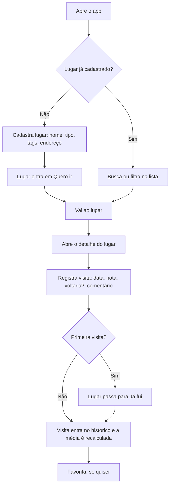
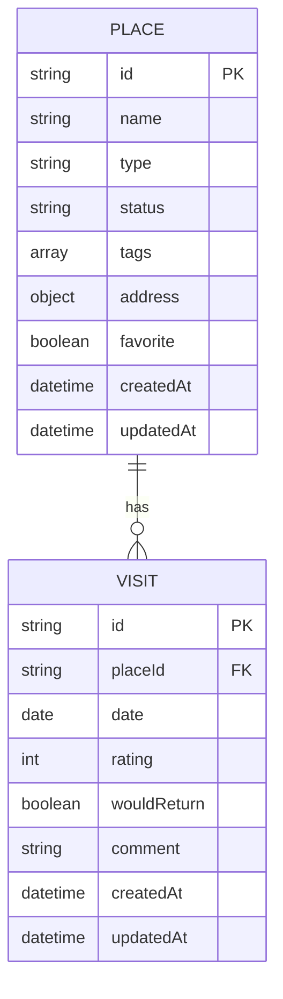

# Refinamento — Diário de Rolê

07/11/2026 · Thales Alves · [versão online](https://claude.ai/artifact/2yiGmKhPdsJ64BNrgEHpag)

## Visão geral

O Diário de Rolê é um PWA pessoal e offline para guardar os lugares que você quer conhecer e o histórico de cada visita. No MVP não tem publicação, login nem servidor: tudo fica no celular, com backup por exportação.

- **Problema:** indicações e visitas a bares e restaurantes se perdem entre notas, prints e memória. Não existe um lugar só pra lembrar onde ir e o que achou de cada um.
- **Solução:** uma lista "Quero ir" que vira "Já fui" quando a primeira visita é registrada. Cada visita guarda data, nota, "voltaria?" e comentário.
- **Público:** um único usuário (uso próprio), em celular Android.
- **Proposta de valor:** responder rápido "onde a gente vai hoje?" com dados próprios, sem depender de app de terceiros e sem custo de loja.
- **Métricas de sucesso (sugestão):** registrar uma visita em menos de 1 minuto; filtrar "lugares que gostei" em até 3 toques; nenhum dado perdido, com backup exportado ao menos uma vez por mês.

## Escopo

O MVP cobre cadastro manual, visitas, filtros e backup em JSON. Foto, mapa e login ficam para depois.

**Entra no MVP**

- Cadastro manual de lugar: nome, tipo (lista fixa), tags livres e endereço em campos separados
- Status "Quero ir" / "Já fui", que muda sozinho na primeira visita
- Várias visitas por lugar: data, nota de 1 a 5, "voltaria?" e comentário
- Favoritar lugar
- Abas "Quero ir" e "Já fui", com busca por nome e filtros por tipo, tag, favoritos, "voltaria" e nota mínima
- Exportar e importar dados em JSON, com lembrete de backup
- App instalável na tela inicial, funcionando 100% offline

**Fica para depois**

- Fotos nas visitas (comprimidas e com limite por visita)
- Mapa e busca de lugares (Google Places ou similar)
- Login e sincronização entre aparelhos
- Migração da interface para React

**Não-objetivos**

- Rede social, perfis ou avaliações públicas
- Publicação em loja (Play Store / App Store)
- Suporte garantido a iPhone

## Requisitos funcionais

São 14 requisitos no MVP e 3 para depois, no formato ação → resposta do sistema.

| ID | Requisito (ação → resposta) | Prioridade |
| --- | --- | --- |
| RF01 | Cadastrar lugar com nome, tipo, tags e endereço → salva com status "Quero ir" e mostra na aba correspondente | MVP |
| RF02 | Editar lugar → salva as alterações e atualiza listas e detalhe | MVP |
| RF03 | Excluir lugar → pede confirmação e remove o lugar junto com suas visitas | MVP |
| RF04 | Registrar visita em um lugar (data, nota, voltaria?, comentário) → salva ligada ao lugar; se for a primeira, o lugar passa para "Já fui" | MVP |
| RF05 | Editar ou excluir visita → atualiza histórico e média; o status do lugar não muda | MVP |
| RF06 | Abrir detalhe do lugar → mostra dados, média das notas, última visita e histórico (mais recente primeiro) | MVP |
| RF07 | Favoritar / desfavoritar lugar → alterna o coração na lista e no detalhe | MVP |
| RF08 | Abrir o app → mostra as abas "Quero ir" e "Já fui" com os lugares em cards | MVP |
| RF09 | Digitar na busca → filtra a aba atual por nome enquanto digita | MVP |
| RF10 | Aplicar filtros (tipo, tags, só favoritos, voltaria = sim, nota mínima) → mostra só os lugares que atendem a todos | MVP |
| RF11 | Digitar uma tag no cadastro → sugere tags existentes e cria a nova se não existir | MVP |
| RF12 | Exportar dados → baixa um arquivo JSON com todos os lugares e visitas | MVP |
| RF13 | Importar arquivo JSON → valida e pergunta se deve substituir tudo ou mesclar | MVP |
| RF14 | Abrir o app muito tempo após o último export → exibe lembrete de backup | MVP |
| RF15 | Anexar fotos à visita → comprime e salva junto da visita | Depois |
| RF16 | Buscar lugar no mapa → preenche nome, endereço e localização | Depois |
| RF17 | Entrar com conta → sincroniza dados entre aparelhos | Depois |

**Critérios de aceite**

- **RF04 — primeira visita**
  - Dado um lugar em "Quero ir" sem visitas
  - Quando registro uma visita com data, nota e "voltaria?"
  - Então a visita aparece no histórico e o lugar sai de "Quero ir" e aparece em "Já fui"
- **RF10 — lugares que gostei**
  - Dado que existem lugares em "Já fui" com notas e respostas diferentes
  - Quando ativo "voltaria = sim" e nota mínima 4
  - Então só aparecem lugares cuja última visita tem "voltaria = sim" e cuja média é 4 ou mais
- **RF13 — importar mesclando**
  - Dado um backup com lugares que já existem no app (mesmo ID)
  - Quando importo escolhendo "mesclar"
  - Então nenhum lugar é duplicado e, em conflito, fica a versão editada mais recentemente
- **RF13 — arquivo inválido**
  - Dado um arquivo que não é um backup do app
  - Quando tento importar
  - Então o app mostra erro e nenhum dado existente é alterado

## Regras de negócio

O status do lugar muda sozinho para "Já fui" na primeira visita e nunca volta automaticamente.

- **RN01** — Nome e tipo são obrigatórios no lugar; tags e endereço são opcionais. O endereço tem campos separados: logradouro, número, complemento, bairro, cidade e UF, todos opcionais.
- **RN02** — Tipo vem de lista fixa: Bar, Restaurante, Pizzaria, Hamburgueria, Café, Lanchonete, Balada, Outro.
- **RN03** — Tags são livres e um lugar pode ter várias. Não diferenciam maiúsculas ("BH" e "bh" são a mesma tag).
- **RN04** — Todo lugar nasce em "Quero ir" e passa para "Já fui" ao registrar a primeira visita. Excluir visitas, inclusive a última, apaga só o registro: o lugar continua em "Já fui".
- **RN05** — Na visita, data, nota e "voltaria?" são obrigatórios; comentário é opcional. A data não pode ser futura e a nota é inteira, de 1 a 5.
- **RN06** — Cada visita pertence a exatamente um lugar. Excluir um lugar exclui todas as suas visitas.
- **RN07** — O filtro "voltaria = sim" olha a visita mais recente do lugar.
- **RN08** — A média do lugar considera todas as visitas, com uma casa decimal. O filtro de nota mínima usa essa média. Um lugar em "Já fui" sem visitas fica de fora dos filtros de nota e "voltaria".
- **RN09** — Favorito é independente de nota e de status.
- **RN10** — Não é permitido cadastrar dois lugares com o mesmo nome; a comparação ignora maiúsculas e espaços nas pontas.
- **RN11** — Import só aceita arquivos do app com versão de esquema compatível. "Substituir" apaga tudo antes, com confirmação; "mesclar" casa pelo ID e, em conflito, mantém o registro com data de atualização mais recente. Lugar do arquivo com nome já existente e ID diferente não é importado e aparece listado no resultado.
- **RN12** — O lembrete de backup aparece após 30 dias sem exportar, ou se nunca houve export e já existem dados.

## Requisitos não-funcionais

O requisito crítico é não perder dados: tudo vive só no aparelho.

- **Plataforma:** PWA instalável (manifest + service worker), com foco no Chrome para Android. Exige HTTPS para o service worker.
- **Offline:** todas as funções do MVP funcionam sem internet depois da primeira carga.
- **Armazenamento:** IndexedDB, com pedido de armazenamento persistente (`navigator.storage.persist()`) para reduzir o risco de o navegador limpar os dados.
- **Durabilidade:** export em JSON como backup oficial, com lembrete periódico (RN12).
- **Performance (sugestão):** lista, busca e filtros respondem em menos de 200 ms com até 1.000 lugares.
- **Privacidade / LGPD:** nenhum dado sai do aparelho; não há servidor, analytics nem rastreamento.
- **Usabilidade:** mobile-first; registrar uma visita a partir do detalhe em poucos toques.
- **Custo:** zero, com hospedagem estática gratuita.

## Fluxos do usuário

O fluxo central é cadastrar, visitar e registrar a visita; a primeira visita move o lugar para "Já fui".

**Fluxo 1 — Do "quero ir" ao "já fui" (central)**



**Fluxo 2 — Lugar visitado sem planejar**

1. Na aba "Já fui", toca em "Novo".
2. Preenche os dados do lugar e salva.
3. O app abre direto o registro da visita.
4. Ao salvar a visita, o lugar já aparece em "Já fui".

**Fluxo 3 — Escolher onde ir hoje**

1. Abre a aba "Já fui".
2. Abre os filtros e ativa "só favoritos", "voltaria = sim" e/ou nota mínima; opcionalmente filtra por tipo ou tag.
3. Escolhe um card e abre o detalhe para ver o histórico.

**Fluxo 4 — Exportar backup**

1. Abre Configurações / Backup (ou toca no lembrete).
2. Toca em "Exportar".
3. O app gera e baixa o JSON e registra a data do export.

**Fluxo 5 — Importar backup**

1. Em Configurações / Backup, toca em "Importar" e escolhe o arquivo.
2. O app valida o arquivo e mostra quantos lugares e visitas ele contém.
3. O usuário escolhe "Mesclar" ou "Substituir tudo" (este com confirmação extra).
4. O app grava tudo em uma transação e mostra o resultado; se falhar, nada é alterado.

## Telas

São 6 telas no MVP; a tela de início concentra lista, busca e acesso aos filtros.

**T1 — Início (abas)** · RF07, RF08, RF09

- **Objetivo:** ver e encontrar lugares rapidamente.
- **Elementos:** cabeçalho com nome do app e acesso a Backup; abas "Quero ir" e "Já fui" com contador; campo de busca; botão de filtros com indicador de filtros ativos; cards com nome, tipo, tags e coração de favorito (em "Já fui": média e data da última visita); botão flutuante "Novo".
- **Estados:** vazio ("Nenhum lugar ainda — cadastre o primeiro"); sem resultado de busca/filtro (com atalho "limpar filtros"); banner de lembrete de backup (RF14).

**T2 — Filtros (painel inferior)** · RF10

- **Objetivo:** combinar critérios para achar "lugares que gostei".
- **Elementos:** tipos (seleção múltipla); tags (seleção múltipla); "só favoritos"; "voltaria = sim" e nota mínima (1–5), só na aba "Já fui"; botões "Limpar" e "Aplicar".
- **Estados:** sem tags cadastradas (seção de tags oculta).

**T3 — Cadastro / edição de lugar** · RF01, RF02, RF03, RF11

- **Objetivo:** criar ou alterar um lugar.
- **Elementos:** nome\*, tipo\* (select), tags com autocomplete e criação; endereço em campos separados (logradouro, número, complemento, bairro, cidade, UF); "Salvar"; na edição, "Excluir lugar".
- **Estados:** erro de validação nos obrigatórios; erro de nome já cadastrado (RN10); confirmação de exclusão informando quantas visitas serão apagadas.

**T4 — Detalhe do lugar** · RF04, RF05, RF06, RF07

- **Objetivo:** ver tudo sobre um lugar e registrar visitas.
- **Elementos:** nome, tipo, tags, endereço, coração; resumo com média, nº de visitas e "voltaria" da última; botão "Registrar visita"; histórico de visitas (mais recente primeiro) com ações de editar/excluir; "Editar lugar".
- **Estados:** sem visitas em "Quero ir" ("Você ainda não foi aqui" + botão de registrar); sem visitas em "Já fui", após excluir todas ("Nenhuma visita registrada").

**T5 — Registro / edição de visita** · RF04, RF05

- **Objetivo:** registrar uma ida ao lugar em poucos toques.
- **Elementos:** data\* (padrão: hoje), nota\* (5 estrelas), "voltaria?"\* (sim/não), comentário; "Salvar"; na edição, "Excluir visita".
- **Estados:** erro de validação (data futura, campos obrigatórios); confirmação ao excluir a visita.

**T6 — Configurações / Backup** · RF12, RF13, RF14

- **Objetivo:** proteger os dados.
- **Elementos:** data do último export; botão "Exportar"; botão "Importar"; resumo do arquivo antes de importar; escolha "Mesclar" / "Substituir tudo"; versão do app.
- **Estados:** carregando durante import/export; erro de arquivo inválido; sucesso com totais importados.

## Modelo de dados

Duas coleções separadas, Lugar e Visita, ligadas por `placeId` (1 lugar → N visitas). O IndexedDB é não relacional, então a relação é mantida pelo app: um índice em `visits.placeId` faz a busca, e a exclusão em cascata roda numa transação.

Código, nomes de campos e valores gravados são em inglês; só os textos da interface ficam em português.



| Campo | Significado | Valores |
| --- | --- | --- |
| `place.type` | Tipo (RN02) | `bar` Bar · `restaurant` Restaurante · `pizzeria` Pizzaria · `burger` Hamburgueria · `cafe` Café · `snack_bar` Lanchonete · `nightclub` Balada · `other` Outro |
| `place.status` | Status (RN04) | `want_to_go` Quero ir · `been_there` Já fui |
| `visit.date` | Data da visita | `YYYY-MM-DD` |
| `visit.rating` | Nota | inteiro de 1 a 5 |
| `visit.wouldReturn` | Voltaria? | `true` / `false` |

**Object stores no IndexedDB**

| Store | Chave | Índices | Observação |
| --- | --- | --- | --- |
| `places` | `id` (UUID) | `name`, `type`, `tags` (multiEntry), `status` | Status é gravado; média e última visita são calculadas. Sem índice em `favorite` (boolean não é chave válida no IndexedDB) |
| `visits` | `id` (UUID) | `placeId`, `date` | Toda visita aponta para um lugar existente |
| `meta` | `key` | — | Guarda `schemaVersion`, `lastExportAt` e `persistentStorage` |

- IDs são UUIDs gerados no aparelho (`crypto.randomUUID()`), o que permite mesclar backups sem colisão.
- A lista de tags é derivada dos lugares; não existe cadastro separado de tags no MVP.
- O endereço é um objeto embutido no lugar: `{ street, number, complement, neighborhood, city, state }`.

**Formato do backup (JSON)**

```json
{
  "app": "diario-de-role",
  "schemaVersion": 1,
  "exportedAt": "2026-11-07T18:30:00.000Z",
  "places": [ { "id": "…", "name": "…", "type": "bar", "status": "been_there", "tags": ["rooftop"], "address": { "neighborhood": "…", "city": "…", "state": "MG" }, "favorite": true } ],
  "visits": [ { "id": "…", "placeId": "…", "date": "2026-11-01", "rating": 5, "wouldReturn": true } ]
}
```

## Visão técnica

JS vanilla com ES modules e IndexedDB, em camadas separadas, para que a migração para React reescreva só a interface.

**Stack**

- HTML + CSS + JavaScript vanilla (ES modules), sem etapa de build.
- IndexedDB direto ou com o wrapper `idb` (~1 KB), que troca callbacks por Promises.
- Web App Manifest + service worker (cache dos arquivos para uso offline).
- Hospedagem estática gratuita com HTTPS: GitHub Pages, Netlify ou Cloudflare Pages.

**Camadas**

1. `db/` — abre o banco, cria stores e índices, faz migrações de versão. Único ponto que conhece o IndexedDB.
2. `services/` — regras de negócio puras (status, média, filtros, validação, import/export). Não toca no DOM.
3. `ui/` — telas e componentes; chama apenas `services/`.
4. `sw.js` — service worker com cache versionado.

**Caminho para React:** `db/` e `services/` são reaproveitados como estão; só `ui/` é reescrita. Por isso a regra de ouro é nenhuma lógica de negócio dentro dos handlers da interface.

**Pontos de atenção**

- Versionar o cache do service worker para o app atualizar quando você publicar mudanças.
- Gravar `schemaVersion` desde a v1 e tratar migrações no `onupgradeneeded`, pensando em fotos e sync no futuro.
- Fotos (v2): salvar como Blob no IndexedDB após compressão via canvas; o backup passa a ser um .zip (JSON + imagens).

## Riscos e perguntas em aberto

O maior risco é perder dados guardados só no celular; o resto é escopo e evolução.

| Risco | Impacto | Mitigação |
| --- | --- | --- |
| Limpar dados do navegador, reinstalar ou trocar de celular apaga tudo | Alto | Export JSON, lembrete de 30 dias, armazenamento persistente |
| Escopo crescer antes do MVP rodar (fotos, mapa, login) | Médio | Itens já separados em "Fica para depois" |
| Mudança de esquema quebrar backups antigos | Médio | `schemaVersion` no banco e no JSON desde a v1, com migração |
| Arquivo de import corrompido ou de outra versão | Médio | Validar tudo antes de gravar; gravar em uma transação |
| Uso futuro em iPhone | Baixo | Fora do MVP; Safari limpa dados de PWA não instalado |

**Perguntas em aberto:** nenhuma. Todas foram fechadas no refinamento de 07/11/2026.

## Premissas assumidas

Todas as regras de negócio foram confirmadas no refinamento. Restam só estas premissas, que não mudam escopo nem modelo:

- Métricas de sucesso e meta de performance são referências para avaliar o MVP, não critérios de entrega.
- O uso do wrapper `idb` é opcional; a camada `db/` pode usar a API nativa do IndexedDB.
